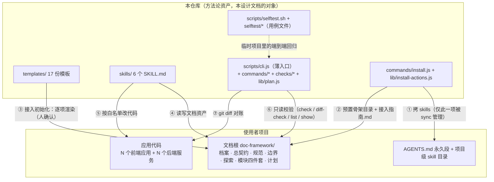
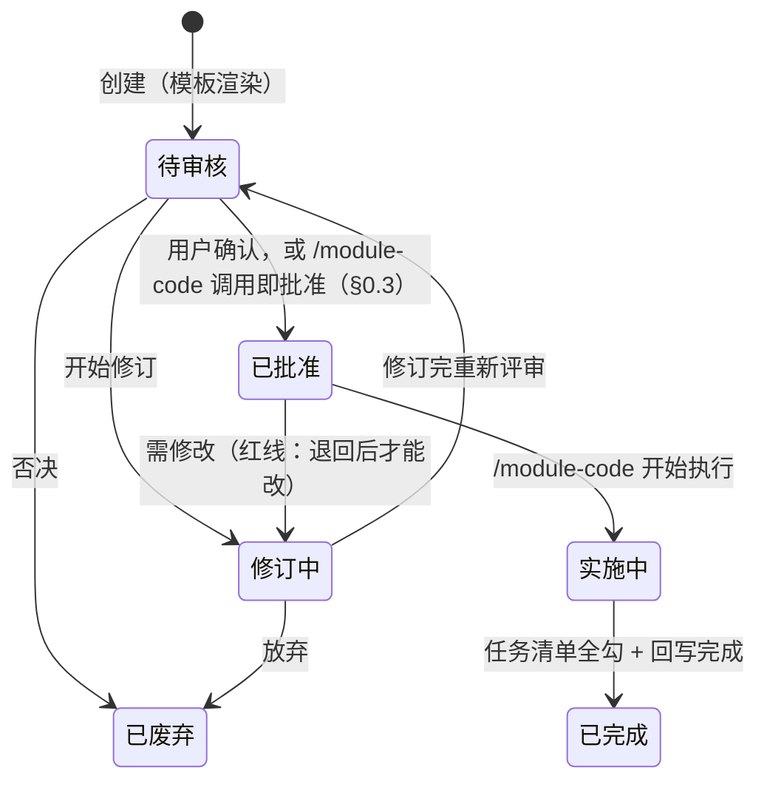
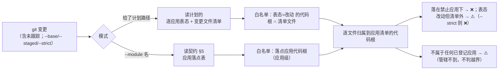

# doc-framework 设计文档

> **读者**：要改这套框架本身的人——改 `scripts/`、`skills/`、`templates/` 的开发者（含接手本仓库的 AI）。
> **不是**给使用者的：装了这套框架、在自己项目里跑六个 skill 的人看 [`README.md`](../README.md)。

## 0. 阅读约定

1. **本文是"当前实现"的权威描述**——描述仓库里的代码**现在**怎么做。设计辩论的原始提案放在 `plan/`（**编号提案与方案报告，清单见该目录——此处不重复枚举，避免必然腐坏**），**`plan/` 被 gitignore**，外部读者拿不到，所以本文**自包含**：不写"详见 `plan/xxx.md`"，需要讲清的就在这里讲清。
2. **提案 ≠ 现状**：`plan/` 记录的是"当时为什么这样改、否掉了什么"；代码与本文才是现状。两者冲突时以代码为准，并回来改本文。
3. **冲突时的优先级**：`scripts/`（机器行为） > `skills/` 与 `templates/`（AI 行为与骨架） > 本文 > `README.md`（使用者摘要）。
4. **清单类内容只有一个权威来源**，本文不复制正文、只指路：
   - 校验规则实现 → `scripts/commands/check.js` 编排 + `scripts/checks/*.js`（8 个阶段）；规则码/级别 → `scripts/checks/rules.js`（`check --rules` 的单一来源）；解析语义 → `scripts/lib/plan.js`；
   - 产物命名 → `scripts/lib/plan.js` 的 `NAMES.zh`（唯一词表，**无第二套、无历史别名**）；
   - 自检用例清单 → `scripts/selftest/NN-*.sh` 各文件头部注释（runner 是 `scripts/selftest.sh`）。
   本文给出**结构化描述与规则表**（帮读者建立地图），但**数字与逐条清单不在此维护**——那正是上次 README 反复漂移的原因。

---

## 1. 本仓库是什么

`doc-framework` 把一套在真实全栈项目中验证过的开发方法——**面向文档开发**（Document-Oriented Development）——抽象成**可跨项目复用的方法论资产**。仓库只装三件东西：

| 目录 | 是什么 | 谁消费 |
|------|--------|--------|
| `templates/` | 17 份骨架模板（13 份文档模板 + 4 份模块四件套） | 使用者项目**接入初始化**时一次性渲染；升级不覆盖已渲染的资产 |
| `skills/` | 6 个 `SKILL.md`（`module-explore` / `module-doc` / `module-plan` / `module-code` / `module-review` / `module-test`） | 拷进使用者项目的 skill 目录，被 AI 加载执行 |
| `scripts/` | `cli.js`（**薄入口**：argv 分发 + `--help`）、`commands/*`（八个命令）、`checks/*`（check 的 8 个阶段，含 `rules.js` 规则目录）、`lib/plan.js`（文档解析器）、`lib/env.js`（项目根/版本解析）、`lib/installer.js`（marker / 哈希 / 目标目录）、`lib/util.js`（命令层共享工具）、`commands/install.js` + `lib/install-actions.js`（唯一安装入口；v3 起无 install.sh / postinstall）、`selftest.sh` + `selftest/*`（自检 runner 与用例文件） | 使用者的终端 / CI；以及本仓库自己的回归 |

| `test/` | `node:test` 单元测试（解析器 / env / installer；不进发布包） | 仓库自检（`npm test`）；与 bash selftest 分工 |

**仓库不装**：任何使用者项目的文档资产（契约、计划、探索记录）。这些生成在使用者项目的文档根 `doc-framework/`（中文）或 `doc-framework-en/`（英文）下，**永不回灌本仓库**（§9.4）。

**边界一句话**：本仓库管"规矩与骨架"，使用者项目管"内容"。所以本仓库的改动永远不碰使用者的契约正文。

---

## 2. 总体架构

### 2.1 分层



四层职责，**不要跨层偷懒**：

| 层 | 载体 | 性质 | 能做什么 | 不能做什么 |
|----|------|------|----------|-----------|
| 模板层 | `templates/**` | 静态骨架 | 定义节名、字段名、占位符 | 不能改已渲染的项目资产（§5.4） |
| 技能层 | `skills/*/SKILL.md` | AI 行为约束 | 探测、确认门、读写文档与代码 | 没有机器强制力——靠流程与确认门 |
| CLI 层 | `scripts/**` | 机器硬校验 | 只读检查、git 对账、安装/同步 | **不读源码、不扫代码库**（§7.5 能力边界） |
| 资产层 | 使用者项目 `doc-framework/` | 用户资产 | 长期真相 | 不在本仓库内，永不回灌 |

### 2.2 一次改动的完整数据流

```
需求（只给业务描述）
  → [可选] /module-explore      零承诺探索；待实现模块场景强制落盘探索记录
  → 通道判定                    触语义 / 含 SQL → 完整计划；跨应用 → 轻量；单应用小改 → 直改
  → /module-plan                语义写进「语义增量」节；批准 = 语义定稿 + 授权作用域
  → /module-code                按增量 + 契约不变量实施（「待审核」→ 调用即批准：先登记「已批准」）；逐项勾任务；白名单为边界
  → diff-check                  机器对账（计划白名单 / 直改用契约 §5 落点）
  → /module-doc 合并增量          按增量合并进契约正文与接口.md → 翻「合并状态=已合并」（留痕在 git 提交信息 trailer）
  → /module-review              34 项检查（含增量合并完整性、通道合规审计、回写查账=check 文档落后判据）
  → /module-plan 归档           校验 合并状态=已合并 且契约已承接 → 移入 计划/归档/（独立动作）
```

**关键不变量**：契约**永不领先代码**——所以语义先写进**计划**（待生效），实施后由合并增量**落账**（已生效）。这条决定了技能分工、模板节设计、以及 `check` 的全部 v2.2 规则（§3.4）。

### 2.3 四条核心设计原则

1. **skill 不焊死任何技术栈**：所有项目特定约定收敛到项目档案（`项目档案.md`），skill 一切配置从档案读取——换技术栈只换档案，不换技能。
2. **一个文档根 × N 个应用**：档案「应用清单」是 skill 的路由表（应用 → 类型/代码根/规范/数据库/依赖）。可见性 ≠ 上下文——skill 只加载涉及应用的规范与标杆。计划「逐应用表态 + 变更文件清单」即 `/module-code` 的路径白名单；直改通道以契约 §5 应用落点为应用级白名单。
3. **人机共读**：依赖图 / 状态机 / 页面结构 / 业务流程一律用 mermaid 绘制（模块依赖全景图、跨模块业务流程归总契约）——人类阅读与 AI 实施共享同一份文档。
4. **上下文从体系中来，不从人肉中来**：关联文档与代码地址是体系的自动产出（档案 → 总契约 → 导航区 → 代码扫描兜底），用户只给业务需求。

---

## 3. 契约模型规格（v2.2）

这一章是整套体系的地基，也是 `check` 的规则来源。

### 3.1 模块三态

| 状态 | 判定 | 路径 |
|------|------|------|
| **待实现模块** | 代码库中**零实现**（无目录 / 路由 / 表 / 接口 / 契约） | `/module-explore`（**强制落盘**）→ `/module-plan`（首次建模计划）→ 实施 → `/module-doc` 合并增量的 `create` 建档 |
| **存量模块（已建档）** | 有实现 + 有契约 | `/module-plan`（计划增量）→ 实施 → `/module-doc` 合并增量的 `update` 落账 |
| **存量模块（未建档）** | 有实现 + 无契约（接入体系时已有代码） | `/module-doc` **代码对账**补建（不走计划） |

**反例（最容易混的一处）**：存量模块未建档 ≠ 待实现模块。只要有一行代码 / 一张表 / 一个接口，它就是存量模块，走代码对账；待实现模块是"计划时刻"的状态，实施一落代码就转成存量模块。

**定名取舍**：中文用「待实现模块」，**弃用"绿地"**——中文"绿地"的真实搭配是"绿地开发/工程/项目"，"绿地模块"不是自然搭配，且直译词依赖"棕地"成对出现才成立。英文保留 `greenfield`（`first-build` 为正式术语，`greenfield` 作同义词）。

### 3.2 首次建模计划的判定式

**不新增「计划类型」字段**——类型由依据推导，避免多一个要人工维护、且会与依据矛盾的字段：

```
首次建模计划  ⟺  无「依据模块契约」 ∧ （有「依据探索记录」 ∨ 有「语义增量」节 ∨ 有「建模补充」节）
```

约束（`check` 硬校验，规则表见 §6.3）：必须 `完整` 形态、必须含「语义增量」全量（几乎全是 ADDED）与「建模补充」节。轻量形态不承载语义，用来承载首次建模会产出"零信息建档"。

### 3.3 语义增量（Delta）

计划的「语义增量」节是**语义变更的唯一载体**，三张固定表 + `主计划` 列：

| 表 | 列（模板固定，`parseDelta` 按此解析） | 装什么 |
|----|--------------------------------------|--------|
| `ADDED（新增）` | `# \| 目标位置 \| 对象 \| 内容 \| 主计划` | 新字段/表/接口/状态机状态/权限标识 |
| `MODIFIED（修改）` | `# \| 目标位置 \| 对象 \| 现值 \| 目标值 \| 主计划` | 语义被改写的对象（现值/目标值是**两列**） |
| `REMOVED（删除）` | `# \| 目标位置 \| 对象 \| 理由 \| 主计划` | 删除项 |

三表的**第一数据列都是「目标位置」**（这是 `check --draft-contract` 能按章节派发的前提），第三列按表语义不同：ADDED 是「内容」、MODIFIED 是「现值 + 目标值」两列、REMOVED 是「理由」——解析后统一装进 `detail`（MODIFIED 拼成 `现值 → 目标值`）。

- **只写目标语义**（不写实现步骤）：每条指明**目标位置**，可被机械合并——这是 `check --draft-contract` 能输出"增量条目 → 契约章节"清单的前提；
- **一份语义变更只由一份计划承载**：拆分计划在「主计划」列回指主计划（同模块两份都为空且增量非空 → I3 ❌）；
- **位置**：模板里固定在「逐应用表态」之后、「变更文件清单」之前——因为它是"授权语义"，要和"授权作用域"（表态 + 清单）相邻；
- **空增量**：纯实现改动写"无（纯实现改动）"，并把合并状态标 `无需合并`。

### 3.4 合并状态三值与四条不变量

`合并状态`（计划头部字段，如 `> 合并状态：已合并`）三值，与计划状态**正交**（旧英文枚举 `pending/merged/n/a` 不再识别，见 §8.3）：

| 值 | 含义 |
|----|------|
| `待合并` | 增量已实施未落账 |
| `已合并` | 已由 `/module-doc` 合并进契约与接口.md |
| `无需合并` | 空增量（纯实现改动）或计划已废弃 |

四条不变量（设计目标，也是机器校验抓手）：

| # | 不变量 | 违反后果 |
|---|--------|----------|
| **I1** | 契约 ⊆ 代码事实（契约声明的东西必须真实存在） | `/module-review` #11 报"契约有、代码无"（漏实施） |
| **I2** | `状态=已完成 ∧ 增量非空 ∧ 合并状态≠已合并` → ❌，**且拒绝归档** | `check` 硬报错——不能带着未落账的语义归档 |
| **I3** | 同模块 ≥2 份「主计划」列为空的**非空**增量 → ❌ | `check` 硬报错——语义变更被拆散、无主。**已合并但尚未归档的计划仍计入**：同模块同一时刻只允许一份"无主的非空增量"，换新计划前先归档，或在「主计划」列回指 |
| **I4** | 增量的出口只有两个：合并，或废弃（标 `无需合并`） | 废弃计划必须把标记写成 `无需合并`，否则永远挂在"待合并" |

**I2 的归档兜底**：`git mv` 进 `计划/归档/` 不能绕过唯一机器硬校验——`check` 用 `collectArchivedPlans()` 扫模块目录与全局两个归档目录（只认中文 `归档/`，**英文 `archive/` 不再识别**），对归档计划同样做 I2 判定。混排布局里的 `archive/` 不会被当成归档目录，但它下面的计划仍会按在途计划枚举（`isPlanLike` / 日期前缀），**不会被漏掉**。

### 3.5 计划形态与三通道

**授权粒度 ∝ 爆炸半径**：改一个文案的授权，不该和"改状态机 + 加表 + 三端联动"共用一套文档。三条底线**不可让渡**——AI 不能自我授权（必须有一次人的确认）、不能改到范围外的应用、事后可追溯。计划通道的"人的确认"同理：**显式调用 `/module-code` 执行某份计划本身就是那次确认**（「调用即批准」，见 §3.6），AI 不得在没有任何人指令的情况下自己挑一份计划执行。

判据（自上而下，先命中先定）的**唯一权威源是 `skills/module-code/SKILL.md` §0.1**——本文不复述全表，只记设计要点：触语义 / 含 SQL → 完整计划；跨应用 → 轻量计划；单应用 + ≤5 文件 + 无决策 → 直改通道。判据 1 的客观形式（"这个改动能不能在契约里找到对应条目？找得到是实现，找不到就是语义变更"）也在该判据表内。

**轻量计划**是同一份计划格式的低档位：保留 `1 需求与思路（四小节各一句，图按需）/ 逐应用表态 / 变更文件清单 / 任务清单` 四节，头部标 `> 计划形态：轻量`，**不含语义增量节**。`check` 对轻量计划的表态与清单**缺一即 ❌**（它们是白名单），且**含非空增量即 ❌**（形态判错，应升级完整计划）。

**批准粒度从"任务"上移到"作用域"**——这是省成本的关键：

- 批准的对象是**作用域**（表态 + 清单）；扩作用域 = 扩权 → 必须退回「修订中」重新批准；
- **作用域内追加任务项 = 记账**，可直接更新 → 一份轻量计划承接同范围多轮小改，不必每次新建；
- 「已完成」计划不得追加任务（那是新改动）。

**直改通道**（免计划小改）：

- **边界来源 = 契约 §5 应用落点表**（应用级）——契约本就是长期真相，"这个业务在哪些应用存在"天然定义"这次能碰哪些应用"，所以 §5 的准确性是直改的前提；
- **硬禁用**（不进判据权衡）：SQL 与生产数据、状态机、权限标识、跨应用不变量、公共契约/共享库；
- **一次编号确认**（与 `/module-doc` 的模式确认门同构），AI 不得自我授权；
- **自动升级**：途中发现要动语义 → 立即停 → 升级完整计划 → 计划通道重做；已改部分如实汇报；
- **留痕在 git 提交信息**（v2.8.0）：按 AGENTS.md §5 的 trailer 约定——`模块:{模块名}` + `计划:无` + `契约:无需变更`（直改 = 只动实现；`契约:无需变更` 是 check 文档落后判据豁免该提交的唯一出口）；
- **对账**：`doc-framework diff-check --module {模块名}`。

### 3.6 计划状态机、落盘与红线



- 状态是**事实登记**：AI 登记、用户确认流转；评审在文档内或文档外皆可；
- **「已批准」有两个入口**：用户确认；或 `/module-code {计划路径}` 的**调用即批准**——显式调用执行「待审核」计划时，由 `/module-code` 先把状态登记为「已批准」（**只改头部状态行**）再实施。**人的确认就是那次显式调用**，不是 AI 自主批准：只给 `{模块名}` 时先列清单等编号（不得替用户挑一份计划），「修订中」（语义可能未定稿）、「已废弃」、「已完成」与状态缺失一律不自动批准（详见 §4.4 与 `module-code/SKILL.md` §0.3）；
- 「实施中 / 已完成」由 `/module-code` 登记，`/module-plan` 不登记；**存在未勾选的勾选行时不得登记「已完成」**；
- **任务清单是进度事实源，判据只有一条：勾选框 ⇔ AI 可执行可验证的任务**（v2.10.0）——`- [ ] 组.序号 任务`＝AI 动作（未勾选阻塞「已完成」）；`- 组.序号 【人工·{执行方}】{动作}`＝只有人能做的步骤（**不带勾选框**，只显示、不进进度、不阻塞）；测试与验证任务**不写**（归 `/module-test`）。每完成一项就地勾选（只勾事实完成的项；**能勾的只有勾选行**——登记行无框可勾、不由任何人勾）；
- **红线：已批准计划不可直接修改**——退回「修订中」→ 改 → 「待审核」重新评审；**修订就地改写正文**（计划只呈现**最新方案**：不追加版本行、不保留旧方案），被否方案与理由归探索记录、历史归 git（`git log -p <计划>`）；
- **归档不是状态，是位置**：已完成/已废弃的计划由 `/module-plan {模块名} 归档` 移入 `计划/归档/`，归档时**校验 `合并状态=已合并` 且契约已承接**。**归档是独立动作**（实施完成 ≠ 可以归档，可能还要等生产 SQL 执行、等验收）。**归档 ≠ 删除：skill 不自动删除任何计划文件**，是否清理由人手动决定。
  > **为什么不自动删除**：归档计划没有任何枚举入口（`check`/`list` 都跳过它，需路径直达），确实可能堆积；但它同时是**当时的最新方案快照**（含语义增量的落账凭据、任务进度与验收口径），而**删除不可逆**。所以：skill 只负责归档与写入追溯凭据，**清理权交给人在需要时执行**（`git rm`，git 历史里仍留痕）。长期追溯靠 **git 提交信息的 trailer（`计划:{计划标识}`）**：提交 → 当时真实的代码与计划快照，**不依赖计划文件存活**；**决策理由（"为什么这么做、为什么不那样"）的唯一长期归属是探索记录**（v2.8.0 起契约 §9 不再有表，凭据归 git）。

**两类计划的落盘位置**：

| 类型 | 判定 | 位置 |
|------|------|------|
| 单模块计划（默认） | 只涉及一个模块 | `模块/{模块名}/计划/YYYY-MM-DD-{主题}.md` |
| 跨模块计划 | 「依据模块契约」多行 | `计划/YYYY-MM-DD-{主题}.md`（全局，只能用 `{计划路径}` 直达） |
| 归档 | 已完成/已废弃后 | 同级 `计划/归档/`（归档后不进 glob 清单，需路径直达；**不自动删除**，清理由人决定） |

**三个触发形式**：`{模块名}`（glob 列清单，回复编号选择；无匹配自动新建）、`{计划路径}`（直达，跨模块唯一入口）、`{模块名} {YYYY-MM-DD-主题}`（精确匹配单模块计划）。归档：`{模块名} 归档`。

**归档三道守卫**：① 未完成状态禁止归档；② `已完成 ∧ 合并状态=待合并` 拒绝归档（先由合并增量落账）；③ **契约登记完整性**——增量已落账、§5 落点/§8.2 场景/§10 SQL 已登记、计划「本计划特有落账项」行逐项已清、提交信息带 `计划:{计划标识}` trailer，任一缺失拒绝归档。`已废弃` 允许归档，但归档前应把标记写成 `无需合并`。

**正交通道小结**（`/module-code` 的目标来源）：

| 计划形态 | 约束来源 |
|----------|----------|
| 完整计划 | 「语义增量」+ 契约不变量 |
| 轻量计划 | 表态 + 变更文件清单（白名单） |
| 无计划（直改） | 契约 §5 应用落点（应用级 + 硬禁用清单） |

### 3.7 常见误解（全表）

| 误解 | 正确理解 |
|------|----------|
| 计划确认后会自动实施 | 必须显式调 `/module-code`（计划得有人发起执行）；发起即批准——「待审核」被显式调用时登记为「已批准」 |
| 执行计划前必须先把计划改成「已批准」 | 不必：`/module-code {计划路径}`（或清单里回编号）**调用即批准**，它自己登记「已批准」再实施；只有「修订中 / 已废弃 / 已完成 / 状态缺失」才拒绝 |
| 已批准的计划可以直接改 | **作用域**与**语义增量**都不能；红线是退回修订流程。作用域内追加任务项是记账，可直接更新 |
| 任务清单可以最后一起勾 | 每完成一项就地勾选；未勾完不得登记「已完成」 |
| 人工/平台侧步骤要勾完才能归档 | 不必——它们写成**不带勾选框的登记行**（`- 5.2 【人工·生产】…`），只显示、进不了进度、不阻塞「已完成」；勾选框只留给 AI 能自己干完并验证的事。**登记行不由任何人勾选**（也不要求填"去向"之类字段） |
| 「已完成」的计划还能追加任务 | 不能——那是新改动，新建计划或先退回修订中 |
| 实施完成就自动归档 | 归档是独立动作，时机由人定；`list --stale N` 帮你找攒久的 |
| 跨模块计划放在某个模块目录里 | 在全局 `计划/`；`{模块名}` 只匹配模块内计划 |
| 计划是长期规范依据 | 计划是**当时的最新方案快照**（不记修订史／决策史；被否理由归探索记录、历史归 git），归档后不作规范依据；长期看契约正文（当前真相）与 git 提交（历史，trailer 追溯） |
| 改计划 = 改代码，说一声就行 | 代码只认「已批准」的计划 |
| 小改也得先建计划 | 不一定——单应用、不触语义、无 SQL 走直改通道（但要过编号确认 + 边界 + 留痕） |
| 直改 = AI 说一声就能改 | 必须给编号确认门由用户确认；AI 不得自我授权 |
| 语义变更写进契约正文 | 写进计划的增量节；实施后由合并增量落账（契约永不领先代码） |

### 3.8 成本模型（为什么这么设计）

| 场景 | 改造前 | 现在 |
|------|--------|------|
| 单次小改（单应用 3 文件） | doc（探测+确认）→ plan（渲染 8 节）→ 批准 → code → 归档 = 5 步 | `/module-code`（探测 + 编号确认）= **1 命令 + 1 次确认**，无归档 |
| 一迭代 5 次同范围小改 | 5×(建→批→执行) + 5 次归档 ≈ 20 步 | 1 次轻量授权 + 5 次执行（作用域内追加任务）+ 1 次归档 = **7 步** |
| 真正的功能开发 | 完整计划 | **不变**（决策记录、接口兼容性、验收标准正是完整计划的价值） |

**防滥用三条**（缺一条设计就烂）：① 禁止 AI 自降级（任何免计划判定都要过编号确认门）；② 自动升级永远安全、降级必须人确认；③ 事后审计——`/module-review` 第七节「通道合规审计」专查"本该建计划却直改/轻量""直改越界""作用域就地篡改"，这是防止直改通道吃掉"语义先于代码、记录后于代码"纪律的唯一手段。

### 3.9 探索记录状态机与归档（v2.7.0）

探索记录是**单次决策记录**，但"定案即完结"并不等于"立刻进归档"——定案后往往还要等计划/文档来吸收它。位置即状态：

| 状态 | 含义 | 位置 |
|------|------|------|
| `探索中` | 探索未完，中间结论先记下 | `探索/` |
| `已定案` | 结论已出、**待吸收**（等计划/边界文档消费） | `探索/` |
| `已使用` | 结论已被计划 / 边界文档 / 契约消费 | `探索/归档/` |
| `已作废` | 结论被推翻/放弃（含被新记录取代） | `探索/归档/` |

流转规则（写权限归属是设计要点）：

- **探索中 → 已定案**：定案落盘时按**去向分流**——去向 ∈ {已立项, 已并入文档} 的留在 `探索/` **待消费**（根目录 = "待吸收结论"工作清单，`doc-framework list --explore` 默认视图）；去向 = 维持"不做"/仅讨论的，**定案即移入 `探索/归档/`**（状态`已定案`，归档里照样止重复讨论）；
- **已定案 → 已使用**：由**消费方**执行——`/module-plan` 立项（首次建模/已定案立项）或 `/module-doc` 并入边界文档。两个技能对探索记录只有**机械记账权**：翻状态、移目录、补 `结论去向` 实际路径；**正文永不改写**。时序**先写后移**：计划头「依据探索记录」填**移动后的最终路径**（`探索/归档/…`），再翻转+移动（否则计划头指向失效路径，check 的"路径必须存在"硬报错）。多消费者时首个消费者执行翻转+移动，后续只追加第二条去向；
- **已定案 / 已使用 → 已作废**：**被新探索推翻时由 `/module-explore` 执行**（它是探索记录的唯一内容写手与状态机执行者）——新记录落盘时，同主题旧记录头部状态改 `已作废`、补 `> 已被：{新记录}（一句话原因）`；已在归档的**原地更新，不再移动**；
- `已作废` 记录**可保留也可手动删除**（`已被` 链已把理由传给新记录，删旧不丢链）——与"归档计划不自动删除，清理由人"同一条哲学。

头部三行必填（`> 状态：` / `> 结论去向：` / `> 已被：`（条件行））——`list --explore` 解析它们做聚合；`check` 对探索记录**不硬校验**（避免拖累初始化），状态缺失只显示"未知"。**只认这四个中文枚举，无历史别名**。

边界文档（`边界/{能力}边界.md`）的正规来源由此确定：**`/module-doc` 消费已定案探索记录**生成/更新（§4.1）——此前边界文档没有专属写手，这是"探索 → 长期契约层"的直接通道。v2.8.0 起它还有第二个入口：**回写期的必经归属判定**（见 §3.11），不再只依赖用户开口。

---

### 3.10 文档落后检查（v2.8.0，取代 R3 的判据公式）

**问题**：契约 = 当前代码的语义映射（第一不变量），但"文档是否还对得上当前代码"此前没有任何机器校验——R3 只校验"已存在的 §9 行有没有写凭据"（漏写不报），`/module-review` #4 靠 AI 判断（不稳定）。

**判据（派生基线，文档零字段）**：

```
基线 C = 契约.md 与 接口.md 最后提交中的较晚者（git log -1 多路径一次取）
待查 S = git log --no-merges C..HEAD -- <契约 §5「文件位置」∩ 应用代码根>
未回写 = S 中「提交信息（主题+body）不含 契约:无需变更」的提交；非空 → 提示
```

- **为什么是派生基线而不是显式 `对应提交` 字段**：`契约.md` 这个文件自己的最后提交就是它的锚点，git 已经知道，不需要文档再抄一遍（同一事实不存两份）；且文档与代码**同一次提交**时天然对齐——**最少 1 次提交**（显式锚点强制 2 次）。
- **`契约:无需变更` 是纯实现改动的唯一出口**：缺它则该提交被计为"未回写"（框架明令"不硬写变更记录"，所以必须有这个出口，否则纯实现改动永远挂在警告里）。trailer 格式唯一权威在 `AGENTS.md` 永久段 §5，机器侧常量在 `plan.js`。
- **§5 路径两种写法都要解析**（实施勘误）：应用根相对（`views/order/…`）与仓库根相对（`services/order/src/…`）——**已以应用根开头则原样用，否则拼应用根**；拿错基准 = pathspec 匹配不到任何文件 → 检查静默失效。
- **降级（全部只 ℹ️）**：非 git 仓库 / 文档未提交 / **文档有未提交修改**（改完未提交窗口必误报）/ §5 无可解析路径。基线由 `git log` 从 HEAD 现算 → 必然可达即祖先，**rebase 不会让它失效**（曾设计"基线不在祖先 → 跳过"闸，证伪为不可达的 dead code，已删）。
- **级别**：默认 ℹ️（§5 常是目录级路径，同目录无关提交会命中）；`check --strict` 升 ⚠️ 进退出码（PR / pre-push 门禁）。它的职责是**防"下一次"漂移**——本次改动若代码与文档同提交则天然通过。

### 3.11 规范层归属（v2.8.0，治"应用规范无界膨胀"）

**病根**（实测 zj-ppm：同模板四份应用规范，86~372 行）：`规范/应用-*.md` 是框架里**唯一被流程自动写入的横切容器**（`module-doc` 旧 §3.1 第 5 步"回写范围 = 全部下游文档"），而真正该承载跨应用共享内容的 `边界/` **没有任何流程会自动写它**（唯一写入口的触发条件是"用户要求"）。内容必然全部流向唯一自动可写的容器——结构问题，不是 AI 不听话。

**归属判据（回写期必做一次三选一）**：

| 内容形态 | 归属 |
|---|---|
| 模块语义（表/字段/状态机/接口/落点） | 契约 §3/§4/§5 + 接口.md |
| **≥2 个应用或模块必须一致遵守的约定** | **`边界/{能力}边界.md`** |
| 本端独有的技术栈机制 | `规范/应用-{应用}.md`（深度主题 → 分册 `规范/{应用}-{主题}.md`） |

判据的客观形式采用**"第二个消费者"**（照搬真实项目代码层已验证的规则）：**先写在应用层；被第二个消费者（应用/模块）复用时上移共享位置**——不需要事前预判"将来会不会共享"，只需判断"是否已经共享"（可机器辅助：`check` 的"跨应用同题"判据）。

**应用规范「四不写」**：① 不写变更痕迹（版本/日期/`来源=`/取证过程 → 归 git 与探索记录；「禁止 X」的红线**要留**，留结论删来历）；② 不写代码清单（文件/方法/签名枚举 → 回链代码路径）；③ 不复述上层与兄弟应用（跨应用共享 → `边界/`）；④ 不登记缺口/待办（→ 计划）。

**深度主题分册**（只隔离、不减量）：应用规范降为「技术栈 + 目录结构 + 覆盖项 + 标杆模块 + **技术主题索引表**」，深度主题落 `规范/{应用}-{主题}.md`——让改订单模块时不必读 120 行形态规格。索引 ↔ 分册由 `check` 机检一致（**有机器校验的索引才不会腐坏**）。review 与 module-code 按索引「何时需要读」列**选读**分册，禁止全量加载。

---

## 4. 技能层实现

技能层是 **AI 行为约束**，没有机器强制力——所以每个技能都靠"探测 + 编号确认门 + 铁律"三段式保证可复现。

### 4.1 六个技能的职责边界

| 技能 | 职责 | 明确不做 |
|------|------|----------|
| `module-explore` | 写契约前的探索与讨论：按应用清单路由调研、澄清需求与范围、候选方案对比、有证据的推荐；**探索记录的唯一内容写手与状态机执行者**（探索中/已定案/已使用/已作废，见 §3.9） | 不写契约/计划、不改代码；默认**不落盘**（待实现模块场景强制落盘）；**不越过"契约细节"水位线**（只谈要不要做/放哪/走哪条路/范围，不设计字段接口） |
| `module-doc` | 核心文档（契约/接口）的创建与更新：**三种处理方式自动探测**（合并增量 / 代码对账 / 产物补齐）+ 回写总契约；**消费已定案探索记录生成/更新边界文档**（§3.9 机械记账权） | 不写代码；不创建/修订/归档计划；不做探索讨论 |
| `module-plan` | 计划的创建、修订、状态流转、**归档**（校验 `合并状态=已合并` 且契约已承接 → `git mv` 移入 `计划/归档/`；不自动删除） | 不实施代码；不做契约/接口.md 的合并落账 |
| `module-code` | 执行改动：三通道判定 + 按依赖序实施 + 逐项勾选 + 回写 | 不创建/修改核心文档；不创建/修订/归档计划；**不得自我授权免计划** |
| `module-review` | 对照核心文档（契约/接口）与各应用代码审查，出分级问题清单 | 不改代码，只出清单与修复建议 |
| `module-test` | **可选**：从契约生成测试文档（测试.md）与黑盒脚本（test.sh），多轮讨论定稿；或校验一致性后执行并输出版本化测试报告 | 不创建/更新契约和接口文档；不创建/修订计划；不修改代码；不自动跳转修复通道 |

**防重叠硬规则**：探索中的确认 ≠ 授权写文件（探索的确认只是"方向同意"）；文档的写权限只在 `module-doc`；计划的写权限只在 `module-plan`；代码的写权限只在 `module-code`。

`module-explore` 的**判据**是"选错了返工要动契约/计划/多个模块吗？"——要则先探索；改文案/调样式/单文件小改不必探索。它还有一个隐含职责：**防模块膨胀的刹车**（`module-explore/SKILL.md` §1′）。输出**交接包五项**：目标一句话 / 模块清单与关系 / 范围与「不做」/ 选定方案与理由 / 留给 plan 的未决问题。

### 4.2 `module-doc` 三种处理方式（合并增量 / 代码对账 / 产物补齐）

**零后缀、零参数**：模式由 AI 探测后带编号请用户确认；强制模式回编号或用自然语言。

| 处理方式 | 真相来源 | 产出与停止点 |
|------|----------|--------------|
| **合并增量** | 计划增量 + 建模补充 + **计划 §1.3 的图** + 代码事实 | `update`（存量）：按增量更新契约 §3/§4/§5/§8 + 接口.md（**合并前以代码校正**；若改了状态机，同步用 §1.3 标 `状态机` 的图替换契约 §3.2；偏离写进**提交信息**「实施偏离：计划 X → 实际 Y」）；`create`（待实现模块首次建档）：据增量 + 建模补充（M1 依赖 / M2 验收）+ **§1.3 的状态机/页面结构图**生成契约 10 章 + 接口.md，并回写总契约（模块索引表 / 依赖矩阵 / 应用拓扑）；两分支都**留痕在 git 提交信息**（trailer，格式权威见 AGENTS.md §5）并翻 `合并状态=已合并`（契约 §9 是固定指针节，不再追加任何行） |
| **代码对账** | 代码 | 分组差异清单（必改/建议/仅登记）→ 分组确认 → 回写契约 + 接口.md（**以代码为准**）；**待实现模块拒绝执行**（无代码可对） |
| **产物补齐** | 契约 | 前置一致性检查 → 接口.md → 测试.md → test.sh |

**分支重定向**（判定表里的硬规则）：

- 无契约 + 无代码（待实现模块）→ **重定向 `/module-plan`**：契约永不领先代码，建档在实施后由合并增量的 `create` 完成；
- 无契约 + 有代码 → 代码对账补建历史；带新需求时先代码对账建基线，再 `/module-plan` 增量，实施后合并增量落账（复合流程 **代码对账 → 合并增量**）；
- 无需文档变更：判定不影响契约语义（纯实现/文案/样式）时，说明理由后结束，不硬写变更记录；

**确认门格式**（编号即强制入口，零记忆）：

```
探测事实：契约存在 ✓；代码落点 12 个文件，与契约有差异 → 候选 代码对账
将写入：契约 §3/§4 + 接口.md；不生成测试
1) 确认按「代码对账」执行    2) 改为「合并增量」（按计划增量合并）    3) 改为「产物补齐」（只补 接口.md）
```

**合并增量的铁律（两分支共用）：以代码为准，不照抄计划**。因为契约 = 已生效真相，而计划写的是"批准时的目标"；实施中偏离了就以代码校正，并把偏离记进**提交信息**「实施偏离」——**不回改计划正文**（计划是历史决策记录；v2.8.0 起偏离不写进契约 §9，§9 只剩指针）。

**建档九步**（`create` 分支，`module-doc/SKILL.md` §2.2）在首次建模计划实施完成后执行，`check --draft-contract <计划路径>` 是这条流程的只读 checklist（§6.1）。

**映射表**（`module-doc/SKILL.md` §2.4：「增量 + 建模补充 + 计划 §1.3 的图 + 代码 → 契约章节」）决定"哪些条目落到契约哪一章"，例如契约 §1 定位与 §2.2 不做什么 ← 计划 §1.1/§1.2/§1.4、**状态机图 ← 计划 §1.3 标 `状态机` 的 mermaid 块 → §3.2**、**页面结构图 ← 计划 §1.3 标 `页面结构 · 端名` 的块 → §5（每端一张）**、M1 依赖 → §2.1、M2 验收场景 → §8.2。**新增增量对象类型时，必须同步这张映射表与 `check --draft-contract` 的章节映射。**

**章节映射的机器侧单一来源**是 `scripts/lib/plan.js` 的 `CONTRACT_CHAPTERS`（`check --draft-contract` 的 `chapterOf` 按它把「目标位置」派发到 §1–§10）；selftest §19 有一条守卫断言它与本表列出的章节集合一致，防再次漂移。历史缺陷：`chapterOf` 曾只写死 §3/§4/§5/§8，§1/§2/§6/§7/§9/§10 一律落"未识别 → 人工定位"。

### 4.3 `module-plan` 的护栏

- **增量护栏**：语义变更只能写进「语义增量」节；I3 的「主计划」列语义（拆分计划回指主计划）；首次建模形态约束（必须完整 + 含增量节 + 含建模补充节）；
- **归档守卫**：见 §3.6「归档三道守卫」（含契约登记完整性检查）与 §3.4 I2/I4；
- **跨模块前置校验**：跨模块计划前校验「依据模块契约」已存在（被依赖方是待实现模块时可指向其首次建模计划路径）；
- `list --stale` 提供批量归档入口。

### 4.4 `module-code` 的执行序

执行序与 §2.2 数据流一致（通道判定 → 加载上下文 → 按依赖序实施 → 一致性自检 → 回写），现场纪律三点：

- **调用即批准**（§3.6 的状态流转入口）：定位到的计划是「待审核」→ 先把状态登记为「已批准」（**只改头部状态行**）再实施，并在开工时如实汇报"原为待审核、已按调用即批准登记"；**只改状态，作用域与「语义增量」仍只读**——要改必须退回「修订中」重新批准。「修订中 / 已废弃 / 已完成 / 状态缺失」不适用，一律拒绝执行。一个推论：`diff-check` 的提交前闸门（只放行「已批准 / 实施中」）与这条不冲突——被调用即登记，落到文件上的状态始终是可执行态；
- **白名单自检**（§2）：每次写文件前确认路径 = 表态"改动"应用代码根 ∩ 变更文件清单；
- **回写是交付义务**（§5）：提交信息 trailer（`模块:`/`计划:`/`契约:`）、接口.md 接入状态、总契约索引、计划状态与任务清单。

### 4.5 `module-review` 的七节结构

| 节 | 检查范围 | 编号 |
|----|----------|------|
| 一、通用清单 | 契约↔代码一致性、接口一致、导航区、回写查账、软删除/乐观锁、SQL 参数化、密钥、输入校验、依赖注入、生产 SQL 登记 | #1–#10 |
| 二、多应用对账 | 落点对账（契约 ⊆ 代码事实）、计划表态对账、接入状态、跨服务契约一致、跨应用不变量、应用清单健康 | #11–#16 |
| 三、完成度对账 | 任务勾选属实、状态与进度一致、验收场景可追溯、归档纪律 | #17–#20 |
| 四、测试覆盖完整性 | 黑盒底线、白盒适用判定、端层/编排层适用判定 | #21–#23 |
| 五、模式与增量对账 | 跨应用共享内容归位、应用规范四不写、应用规范与详细层事实源口径冲突、增量合并完整性、待实现模块已实施但未建档、无计划外漂移 | #24、#25、#26、#32–#34 |
| 六、档案注入清单 | 按应用读取技术栈特有检查项 | — |
| 七、通道合规审计 | 本该建计划却走轻量/直改、直改越界、轻量形态合规、作用域就地篡改、直改 trailer 声明真实性 | #27–#31 |

**在途计划豁免**（口径统一在 `module-review/SKILL.md`）：未归档、且 `状态 ∈ {已批准, 实施中, 已完成}` 的计划。同模块存在在途计划时，其增量覆盖的对象**不计私建**——否则"实施 → 合并"窗口内必然误报（#33）。判定顺序：先看有没有在途计划 → 有则核对增量覆盖范围（#26/#33 豁免）→ 无在途计划而代码已落、契约缺失（#32）。

**报告模板**：分级清单 `CRITICAL / HIGH / MEDIUM / LOW` + 检查统计（总/通过/各级数量）+ 完成度 + 测试覆盖 + 通道合规 + 增量与建档四个专节。门禁：CRITICAL 与 HIGH 清零才提示可提交。

---

## 5. 模板层实现

### 5.1 模板清单（`templates/`，17 份）

| 文件 | 作用 | 关键点 |
|------|------|--------|
| `项目档案.md.tpl` | 项目档案（**唯一需人工确认的文件**） | 「应用清单」表 = skill 路由表；通用约定全局段 + 应用覆盖；模板名与产物名一致（v2.4.0 起由 `profile.md.tpl` 改名） |
| `接入指南.md.tpl` | 接入引导（一次性，初始化后删除） | 旧项目扫描 / 新项目提问；「模板来源」标记供初始化拉取 |
| `AGENTS.md.tpl` | 写进项目根的永久段 | 编码纪律总纲（语义先于代码、记录后于代码）；产物命名约定 |
| `总契约.md.tpl` | 总索引 | 业务域、应用拓扑、模块索引表、依赖矩阵 + 全景图、跨模块流程、维护规则 |
| `测试规范.md.tpl` / `接口规范.md.tpl` | 全局方法论与接口约定 | 四层验证（接口/库/端/编排）；接口规范 = **统一响应外层 + 错误码 + 分页 + 接口层字段语义（取值回链档案）** + REST/认证；**兼容性红线**在总契约维护规则与计划「接口兼容性声明」节；**不设「维护」段**（维护规则归总契约 §7） |
| `规范/类型-前端.md.tpl`、`规范/类型-后端.md.tpl`、`规范/应用-{应用标识}.md.tpl`、`规范/{应用}-{主题}.md.tpl` | 规范三层 + 主题分册 | 类型层共性 + 每应用差异（应用层 = 索引 + 分册） |
| `边界/{能力}边界.md.tpl` | 跨模块/跨服务能力 | 工作流/附件/权限/服务间调用/事件与 MQ/鉴权网关 |
| `模块/{模块名}/契约.md.tpl` | **语义约束（业务语义唯一真相）** | 10 章；见 §5.2 |
| `模块/{模块名}/接口.md.tpl` | 字段级服务端真相（唯一事实源） | 服务归属/类型/消费方 + 各应用接入状态 |
| `模块/{模块名}/测试.md.tpl` | 测试用例 | 含**适用层与依据** |
| `模块/{模块名}/test.sh.tpl` | 可执行测试——`模块/{模块名}/test.sh` 的**唯一模板源** | 多服务 `BASE_URL` 参数化 + 流程 `PROCESS_KEY` + 审批用例（`AUDIT_USER` 留空则整段跳过）；只创建不删除、`FAIL>0` 非零退出 |
| `计划/YYYY-MM-DD-{实施主题}.md.tpl` | 实施计划 | 见 §5.2 |
| `探索/YYYY-MM-DD-{主题}.md.tpl` | 探索记录 | 头部状态机（`状态`/`结论去向`/`已被`，见 §3.9）+ 第 5 节「待实现模块清单与关系」 |

### 5.2 关键节设计

**生成文档一级章编号（v2.4.0 起全体系统一）**：**所有渲染进项目的文档**一级章一律 `## N. 标题` 阿拉伯数字，二级节 `### N.M`——全局文档、模块四件套、计划、探索记录、边界文档、类型层/应用层规范**一视同仁**。禁止 `## 一、标题` 这类中文数字章号（v2.4.0 前的模板混用两套，是 AI 每次引用都要做隐式换算的漂移高发点）。

**各文档的实际章节以 `templates/` 为准**——本文件**不复制章节清单**（手工副本必然漂移：v2.8.0 删了应用层规范 §6，本节表就曾与模板不一致）。查章节请直接看模板。

> **解析锚点例外**：计划模板的「语义增量」「建模补充」两节**故意不编号**——`plan.js` 的 `mdSection` 按标题关键字切节（§7.2），加编号会让锚点名称与 `NAMES` 的约定脱钩。同理，解析器只认 `## ` 标题内的关键字，**编号本身不参与解析**，因此章节重编号属低风险改动，但仍须同步全部交叉引用。
> **引用纪律**：跨文档引用统一写 `§N` / `§N.M`（如 `总契约 §6`、`契约 §8.2`）；禁止再写 `§六` 这类中文数字章号。

**契约模板 10 章**：`1 模块定位` / `2 边界约定（2.1 依赖关系 mermaid + 2.2 不做什么 + 2.3 业务流程）` / `3 数据模型（3.1 主表 + 3.2 流程状态机 + 3.3 其他枚举）` / `4 接口概览（4.1 基础路径 + 4.2 接口清单 + 4.3 权限校验 + 4.4 接口对状态的影响）` / **`5 应用落点`（= 直改通道边界来源）** / `6 标杆参考` / `7 特殊约定与常见陷阱` / `8 测试与验证（8.1 测试文档 + 8.2 关键验收场景）` / **`9 变更记录`（v2.8.0 起为固定指针节：历史归 git，不再记表——保留章号避免 §10 重编号与全量交叉引用迁移）** / **`10 生产环境 SQL 执行登记`（防上线遗漏）**。

**应用规范模板（v2.8.0 起）**：`1 技术栈` / `2 目录结构` / `3 栈特有约定（3.1 技术主题索引）` / `4 全局默认的覆盖项` / `5 标杆模块`——**删除 §6 检查项**（并入各主题分册的检查项节，消除 §3↔§6 的文件内自复制）；头部**「四不写」**：不写变更痕迹（归 git）/ 不写代码清单（回链路径）/ 不复述上层与兄弟应用（跨应用共享 → `边界/`）/ 不登记缺口待办（→ 计划）。**深度主题分册** `规范/{应用}-{主题}.md`：`1 主题定位` / `2 约定与红线` / `3 常见陷阱` / `4 本主题检查项` / `5 关联代码`。

**§4 只放接口概览，字段细节一律进 `接口.md`**——防双维护。这是硬规则，不是风格建议。

#### 规则归属（单一职责矩阵，v2.4.0 新增）

**同一规则只写一处，其他位置只回链。** 这是各层防双维护的判据——新增或修改文档时先查此表定位唯一归属；发现同一条规则出现在两处即为漂移缺陷（review 可判）。

| 规则 / 内容 | 唯一归属 | 其他位置怎么写 |
|---|---|---|
| 契约模型总纲（语义增量 / 合并状态 / 三通道） | `AGENTS.md.tpl` 永久段 + 本文件 §3 | 其他文档只回链，不解释机制 |
| 维护规则（16 条） | **总契约 §7** | 接口规范 / 测试规范**不设"维护"段**，只回链总契约 §7 |
| 提交信息 trailer 格式（`模块:`/`计划:`/`契约:无需变更`） | **AGENTS.md 永久段 §5** | 六个 SKILL.md 只引用不复述；机器侧常量在 `plan.js`（`TRAILERS`/`TRAILER_NO_CHANGE`），selftest 单一来源守卫 |
| 生产 SQL 登记义务 | **模块契约 §10** 表头 | 总契约 §7.11 一句 + 回链；类型层规范一句 + 回链 |
| **字段名与取值**（主键 / 软删除 / 审计字段 / 权限标识格式 / 分页参数） | **项目档案「通用约定」** | 类型层规范、接口规范、契约 §3 全部**只回链不复制取值** |
| 分页与统一响应外层（接口层形态） | **接口规范 §3 / §4** | 档案只一句"接口层形态见接口规范" |
| 错误码格式 | **接口规范 §3**（响应体内 `code`；**不带业务域前缀，非 HTTP 状态码**） | 契约 §4 不写错误码明细（见下条判据） |
| 四层验证方法论 + 适用层判定 | **测试规范 §1 / §1.1** | 总契约 / 契约 §8 只回链 |
| 库表 / 字段映射（库层断言用）+ **验证 SQL 骨架** | **项目档案「应用清单」**（映射值）+ **测试规范 §4**（骨架，`{…}` 记法） | 测试规范 §4 只写"按档案映射执行"；各模块取值登记在 `模块/{模块名}/测试.md` §10，**不复制骨架** |
| 验收场景 SC-n | **模块契约 §8.2** | 测试.md / test.sh / 计划 §7 只引用编号，不复制场景 |
| 测试用例类型与通用口径（单级 / 多级审批、编排层） | **测试规范 §3** | 模块 `测试.md` §6 / §8 只填本模块实例（步骤、账号、断言对象），不复制用例行与口径 |
| 跨应用不变量本身 | **总契约 §7** | 契约 §3.2 / §4.4 写逐模块事实，不复述规则 |
| 跨应用/跨模块共享约定（≥2 个消费者） | **`边界/{能力}边界.md`** | 应用规范只写本端机制并回链；判据="第二个消费者"（先写应用层，被复用时上移） |

**契约 §4 的越界判据（机器/人工均可判）**：§4 只允许出现 4.1 基础路径、4.2 接口清单（方法/路径/权限标识/说明）、4.3 权限校验规则、4.4 接口对状态的影响**四类内容**；出现**字段名 / 类型 / 长度 / 必填性 / 请求或响应示例 / 错误码明细 / JSON 结构**即越界 → 一律改放 `接口.md`。该判据同时写在契约模板 §4 节首（AI 写文档时就地可见）与 `module-doc/SKILL.md` §6.2。

**契约 §9（v2.8.0 起）**：固定指针节——**不再有表格、不接收增量**。历史归 git（语义与实现看 `git log -- <模块代码路径>`，本文件自身历史看 `git log -p 本文件`），决策与被否方案归**探索记录**（v2.9.0 起实施计划只呈现最新方案、不记决策史）；保留章号是为了避免 §10 重编号与全量交叉引用迁移。原「来源四值」（`需求/代码/实现/合并`）已下线：其唯一不可替代的信息（"这份契约怎么来的"）压缩为契约头部一行 **`建档方式`**（可选字段，缺失不报错）。

**计划模板结构**：头部字段（`依据模块契约` / `计划形态` / `状态` / `参考标杆` + `依据探索记录` / `合并状态`）→ **`1 需求与思路`（人读层：1.1 需求 / 1.2 实施后结果 / 1.3 思路〔**全计划画图的唯一落点**，图前粗体标注角色〕/ 1.4 不做什么（边界））** → `2 逐应用表态（授权作用域）` → **`语义增量`（位置固定；含「回写去向」与「本计划特有落账项」两行说明）** → `建模补充 M1–M2` → `3 变更文件清单（SQL/服务端/前端应用/其他；**它是授权白名单，不是变更记录**；SQL 表含 `执行环境` 列：`生产+开发` / `仅开发`）` → `4 任务清单` → `5 实施顺序` → `6 接口兼容性声明` → `7 验收标准` → `8 待确认事项`。

**图的唯一落点 = §1.3（v2.9.0）**：需要画图时**一律画在 §1.3**，图前一行粗体标注角色——`**状态机**：`（建档进契约 §3.2；存量计划改了状态机时同步替换）、`**页面结构 · 端名**：`（建档进契约 §5，每端一张）、其他流程/时序图不标角色（仅说明，不进契约）。为什么集中在人读层：① 建模补充只存在于首次建模计划，做不了**两种形态通用**的统一落点——分散落点会导致"有的计划画在这节、有的画在那节"；② 建档要用的图与给人看的图是同一张，**一处画、两处用**（人读 + 建档取图）比两处各画一份更省且不会漂移。`check` 对"首次建模计划 §1.3 无图"给 ℹ️（无状态机也无页面的模块可忽略）。

**§3 的定位（易被误当成"变更记录"而要删）**：它是**事前授权 + 提交前对账**的机器字段——`plan.js` 解析成 `fileList`，`diff-check <计划路径>` 逐文件比对（清单外且应用代码根为 `.` ⇒ ❌ 硬拦）、`check` 据它做四条归属判据。与 git 的分工是**方向不同**：git 记"实际改了什么"（事后事实），§3 记"你被允许改什么"（事前授权）；首次建模计划里这些文件**尚不存在**（`check` 有一条判据正基于此："清单文件已全部存在 ⇒ 疑似存量模块"）。删掉它 ⇒ 计划通道的边界从文件级退化到应用级，而应用级已经是直改通道的粒度（`diff-check --module` 用契约 §5 落点）。

**计划不设的节（有意删除，别再补回）**：`0 修订记录`（不记修订史）、`关键设计决策`（取舍与理由不是计划要展示的东西——**被否理由归探索记录，`module-explore` 是它的唯一长期归属**）、`里程碑`（上线/人工顺序归 §5 与 §4 的 `【人工·…】` 任务行）、`回写清单`（11 条里多数是 `check` 硬校验或 /module-doc 职责的复述，回写动作的唯一权威是 `module-code/SKILL.md` §5；计划只声明「语义增量目标位置」+「本计划特有落账项」）。

**建模补充 M1–M2**：语义增量三张表装不下的**结构化约定**靠本节进契约——M1 依赖与集成点 → 契约 §2.1、M2 关键验收 Scenario → 契约 §8.2（§1 定位与 §2.2「不做什么」取自计划 §1.1–§1.4；§6 标杆参考由建档时探测既有模块得来，不来自计划）。**M2 与契约 §8.2 同词同表**（`场景短名` / `WHEN 触发条件与动作` / `THEN 可观测结果`，与 `测试规范` 同一套词）：建档时**整表落进 §8.2**、只加一行中文标题 `#### Scenario: SC-n {短名}`——**不另立"前置 / 动作 / 期望"一套词**（两套词 ⇒ 每次建档都要人工翻译一次，翻错即漂移）。**本节不装图**：状态机 / 页面结构图统一画在计划 §1.3，建档时按图前标注取图（见上条）。**不设"边界"节**：§1.4「不做什么」已承担模块职责边界，两处都写必然漂移（v2.9.0 前的旧 M1 边界即因此下线）；**不设图节**同理（v2.9.0 前的旧 M1 状态机/页面结构节即因此下线）。

**任务清单不含测试项**：测试是 `/module-test` 的职责，计划的任务清单只装实施动作（含 `【人工·…】` 登记行）。理由有二：① 跨技能共用一份勾选清单会让"进度事实源"失真；② `check` 对"已完成 ∧ 存在未勾选任务"硬报错 ⇒ 计划里放没人勾的测试项 = 计划永远无法登记「已完成」、无法归档（v2.9.0 起写入模板与 `/module-plan` 纪律）。

**勾选框 ⇔ AI 可执行任务；人工步骤是不打勾的登记行（v2.10.0）**：v2.9.0 把「里程碑」节并进 `【人工·…】` 任务行，方向对（人工步骤最需要被记下来），但**该类行同时是勾选框** ⇒ 计入「已完成 ∧ 存在未勾选任务 → ❌」，而 AI 勾不了它（只有人能执行、AI 无法验证）⇒ "计划总是建出没人勾得动的行 ⇒ 永远登记不了「已完成」⇒ 无法归档"（与 v2.9.0 判定测试项为"卡死归档"的**同一个病**）。解法**不是删掉人工步骤**（删了它，"生产该执行 / 平台该注册"就只剩散文，最容易被忘的步骤反而没落点），而是**用记法把语义钉死**：勾选框只留给 AI 能自己干完并验证的事；人工步骤写成**不带勾选框的登记行** `- 5.2 【人工·{执行方}】{动作}`——它进不了进度、不阻塞任何判据，只由 `list` / `show` / `check` ℹ️ 露出。三条连带纪律：① **准入判据**＝不做完本次授权范围不算交付 ∧ 只有人能执行、AI 无法验证（两条都满足才写登记行），避免"每份计划凑一行 5.x 人工样板"；② **登记行不写"去向 / 长期家"之类的指针、也不复制契约 §10 的内容**——任务清单只服务本计划的实施，生产待执行 SQL 的长期家是**计划 §3 的 `生产+开发` 标注 + 契约 §10**（§3 声明它、`/module-code` 登记、`/module-review` 查账），这条链与任务清单无关；③ **零迁移**：v2.9.0 及更早计划的 `- [ ] 【人工·…】` 仍是勾选行 ⇒ 行为与改前完全一致（未勾选照旧阻塞），`check` 只多一条 ℹ️ 指路，**去掉方括号即可**（一步，无需补任何字段）。

### 5.3 占位符与渲染纪律

- `{占位符}` 必须全部替换为项目实际值；**禁止凭空自创结构**——所有骨架一律从官方模板渲染；
- `check` 扫描文档根下所有 `.md`，剥离代码围栏与行内代码后，**只报含中日韩字符**（U+4E00–U+9FFF）的残留占位符（避免误报英文代码片段里的 `{...}`）；**豁免 `探索/`**——探索记录是单次决策记录，允许保留 `{待验证}` 之类的开放标记，不参与硬校验；
- 生成文档必须带**导航区**（核心文档互链），未生成的文件标"（待生成）"。

### 5.4 存档纪律：模板与永久段永不自动改写

**`templates/**` 与使用者的 `AGENTS.md` 永久段永不自动改写**（既有决策）。理由：自动改写用户的项目资产与整套体系"文档资产永不回灌、改文档归技能、AI 不擅自动用户文件"的纪律相冲。

后果（必须知道）：**升级只换 skill，不动文档资产**。模板与 `AGENTS.md` 永久段的改动只惠及新项目初始化；已初始化项目要对齐当前约定，须按 §9.3 迁移清单**人工**执行（命令永不代做，§9.4）。

---

## 6. CLI 层实现

### 6.1 命令清单

| 命令 | 写文件？ | 作用 |
|------|----------|------|
| `doc-framework install [--root] [--json]` | **写**（skill + 未初始化引导） | 唯一安装入口（v3）：装 skill + 未初始化项目的骨架/接入指南/AGENTS 引导；**无 postinstall / install.sh** |
| `doc-framework sync` | **写**（仅 skill 文件） | 同步 skill 到最新；按 **skill** 记版本与 sha256，本地定制/无 marker 同名目录跳过（保留该 skill 旧版本，下次继续尝试）、幽灵技能清理；目标目录缺失 → 退出码 1；**不动文档根与 AGENTS.md** |
| `doc-framework check [--strict] [--json] [--rules]` | 只读 | 校验体系完整性；退出码 0=通过 / 1=有硬问题；`--strict` 把提示类判据（文档落后/规范层归属/契约 §5 落点）升为 ⚠️ 进退出码；`--json` 输出稳定规则码 `DF-*`；`--rules` 打印规则目录 |
| `doc-framework check --draft-contract <计划路径>` | 只读 | 打印"增量条目 → 目标契约章节"清单（含合并/建档九步），供「合并增量」当 checklist |
| `doc-framework diff-check <计划路径>` | 只读 | 提交前对账：git 变更 vs 计划白名单 |
| `doc-framework diff-check --module <模块名>` | 只读 | 直改通道对账：git 变更 vs 契约 §5 落点（应用级） |
| `doc-framework list [...]` | 只读 | 列在途计划（选项全集见 `doc-framework --help`） |
| `doc-framework list --explore [--state <状态>] [--json]` | 只读 | 聚合探索记录（`探索/`=探索中+已定案，`探索/归档/`=已使用+已作废；解析头部 `状态`/`结论去向`/`已被` 三行，状态枚举见 §3.9） |
| `doc-framework show <计划路径>` | 只读 | 单个计划的结构化视图（`--json`） |
| `doc-framework doctor [--root] [--json]` | 只读 | 安装 / 升级健康检查（marker、AGENTS 永久段、旧哨兵、§9 旧表、archive/、旧计划）；**不替代 check** |
| `doc-framework template --list [--json]` / `template <模板>` | 只读 | 打印官方模板（stdout；未作为依赖安装也可用，单安装方式的关键配套） |

**只读纪律**：写命令只有 `install` / `sync`，其余（check / diff-check / list / show / doctor / template）全部只读，可进 CI。`check --json` 带稳定规则码（DF-*）；`list` / `show` 的 `--json` 仍标 **experimental**（格式可能变动）。

`check --draft-contract` 需要分发器传参——历史坑：早期 `cli.js` 是 `process.exit(check())`，`check` 不接收 argv，所以这个选项必须同时改分发器。

### 6.2 命令参数

> **命令参数的唯一权威源是 `doc-framework --help`**（cli.js 的 `help()`，与实现同源发布）——README 与本文件都不复述参数表。各命令的**行为契约**（何时 ❌ / ⚠️、默认视图口径、只读纪律、管辖范围）见 §6.1 / §6.3 / §6.4 / §6.5；本节只留一条命令级历史坑：

- `check --draft-contract` 需要分发器传参——历史坑：早期 `cli.js` 是 `process.exit(check())`，`check` 不接收 argv，所以这个选项必须同时改分发器。
- **项目根**：安装 / 同步 / 校验 / 查询命令支持 `--root <项目根>`（`template` 与项目无关，不接受）；解析顺序 `--root` > `DOC_FRAMEWORK_ROOT` > 从 cwd 向上查找 `doc-framework/` > cwd（`lib/env.js`）。未声明的选项报用法错误（`parseArgs` 白名单），不再静默忽略。

### 6.3 `check()` 规则表

> **规则码 / 级别的运行时权威是 `doc-framework check --rules`**（`scripts/checks/rules.js`）；本节按阶段分组说明，不复制逐条规则码。新增规则时在 `rules.js` 登记 pattern，并在这里补一行分组说明。

规则分两组：**`issues`（❌/⚠️，退出码 1）** 与 **`notes`（ℹ️，不影响退出码）**。注意 ⚠️ 前缀的占位符/引导残留也在 `issues` 里——**它们会失败**。

**① 骨架完整性**

| 检查 | 级别 |
|------|------|
| 必需文件存在（档案 / 总契约 / 测试规范 / 接口规范） | ❌ |
| 必需目录存在（模块 / 边界 / 规范 / 计划——**不含 `探索/`**，探索记录是按需产物） | ❌ |
| 有前端应用 → `规范/类型-前端.md` 存在；有服务端应用 → `规范/类型-后端.md` 存在 | ❌ |
| 档案缺「应用清单」节（清单是必需节，没有"回退旧版规范"这条判据） | ❌ |
| 项目根没有 `doc-framework/`（**只有英文根/旧目录名也算没有**——不做历史目录探测） | ❌ 未找到文档根 |
| 必需文件 / 目录、占位符扫描、模块契约（doc-sync）**读取失败**（权限 / 路径类型）→ 统一走 `ctx.readText` / `listDir` 探针，去重后报一条并把相关校验降级跳过（**不抛 Node 栈、不丢已收集的问题**） | ❌ |

**①A 结构版本哨兵**（R4，v2.4.0 新增；逐份文档读 `<!-- doc-framework:docstruct vX.Y.Z -->`，与框架版本比 **major.minor**）

| 检查 | 级别 |
|------|------|
| 哨兵**存在且落后**于框架版本（如文档 v2.2、框架 v2.4） | ⚠️ 提示按最新模板人工对齐（命令不代做，§9.3） |
| **完全没有哨兵**（v2.4.0 之前的文档）→ 只报**一条汇总**，不逐份刷屏 | ℹ️ |
| 哨兵版本与框架一致或更新 | — 静默 |

> **为什么"落后"进退出码、"没有哨兵"只提示**：哨兵存在意味着文档**明确声明**了自己的结构世代却已跑在新框架上（作者本可对齐而未对齐）→ 属于该修的债；未标记是历史遗留（v2.4.0 之前没有哨兵这回事），而体系纪律是"文档资产永不回灌、结构变更由人手工执行"（§5.4）——**不能用门禁逼用户改写文档**。两者级别不同是纪律要求，不是保守。
> 哨兵覆盖面：四份全局文档 + 计划模板（**仅当存在在途计划时**核对；无计划的项目不该因"缺计划模板"被提示）。**模块契约的哨兵是声明性的**：`模块/{模块名}/契约.md.tpl` 也带哨兵（六份模板之一），但**不参与 R4**——逐模块校验会让存量项目一次性冒出一片 ⚠️，且属"逐模块结构版本"新能力（见 §12.1「哨兵覆盖面澄清」）。

**①B 文档落后检查（v2.8.0 起，**取代 R3 契约 §9 回链凭据校验**；判据公式见 §3.10）**

| 检查 | 级别 |
|------|------|
| 基线（契约.md / 接口.md 最后提交的较晚者）之后，落点路径（契约 §5「文件位置」∩ 应用代码根）有新提交、且提交信息（主题+body）不含 `契约:无需变更` → **文档可能落后**（附未回写提交明细） | 默认 ℹ️；`--strict` → ⚠️ |
| 非 git 仓库 / 契约或接口.md 未提交 / 文档有未提交修改 / §5 无可解析路径 → **跳过**（聚合为一条） | ℹ️ |
| §5 落点应用未在档案应用清单登记（其路径已跳过） | ℹ️ |

> **为什么取代 R3**：R3 只校验"已存在的 §9 行有没有写凭据"（`if (!parsed.rows.length) continue;`——**漏写不报**），机器价值≈0；本判据校验的是**契约是否还对得上当前代码**（框架第一不变量"契约 = 当前代码的语义映射"的机器化），漏回写可被发现。
> **降级设计的两个反误报点**：① 文档有未提交修改时必跳过——"module-doc 改完契约还没提交"是常态窗口，此时基线是旧提交、范围必含代码提交，不跳过必误报；② 基线由 `git log` 从 HEAD **现算**（可达即祖先），rebase 不会让它失效（曾设计的"基线不在祖先 → 跳过"闸证伪为不可达 dead code，已删）。

**①C 规范层归属判据（v2.8.0 新增；判据背景见 §3.11）**

| 检查 | 级别 |
|------|------|
| **变更痕迹**：`规范/` 与 `边界/` 下的 .md 出现——标题 `（vN.x …）`、正文「日期+动词」（如 `（2026-10-09 修正…）`）、`来源=需求/代码/实现/合并`、`已作废/已废弃` → 应归 git（**反误报**：裸日期不报；`YYYY-MM-DD-*.md` 文件引用不报；**只扫规范/与边界/**，计划/探索/测试报告不扫） | 默认 ℹ️；`--strict` → ⚠️ |
| **跨应用同题**：小节标题（剥离尾部连续括注组、去章号后）出现在 ≥2 份应用规范 → 疑似跨应用共享主题，考虑上移 `边界/`；分册主题（文件名）同题同理 | 默认 ℹ️；`--strict` → ⚠️ |
| **小节越界**：应用规范单节 > 80 行，或 ### 小节数 > 8 → 建议拆主题分册 | 默认 ℹ️；`--strict` → ⚠️ |
| **索引 ↔ 分册**：应用规范 §3.1 索引指向不存在的分册（断链）；存在分册但未被索引 | 断链恒 ⚠️；未索引默认 ℹ️、`--strict` → ⚠️ |
| 代码清单密度（反引号内 ≥N 个源码文件 token） | **待真实语料校准后启用**（误报率未定，同 R1/R2 的搁置口径） |

> **索引为什么必须机器校验**："索引必然腐坏"是 §12.1 否掉"归档计划索引"的理由——那个索引没有机器校验。本判据让"应用规范 §3.1 主题索引 ↔ 分册文件集合"始终一致，有校验的索引才不会腐坏。
> **`--strict` 的语义**：把上述提示类判据（①B 文档落后 + ①C 规范层）从 ℹ️ 升为 ⚠️ 进退出码，用于 PR / pre-push 最终门禁；默认级别是 ℹ️（§5 路径常是目录级，同目录无关提交会命中；规范层判据属迁移引导）。
> **判据稳健性**（对应真实项目写法，见 §6.6）：按**表头列名**定位「来源」列（不写死列序）；非路径反引号 token（`ACT_RE_PROCDEF.KEY_` 之类）**不算凭据**——否则真实契约里那些变量名会被误认成引用。
> **v2.5.1 修复的两个解析缺陷**（完整背景见 §12.1 v2.5.1 行，此处只留结论）：① 只认一个表头、把列序套用到整节 → 多列表格把变更内容读成来源（假绿）；修复为列数与表头不一致时**按取值白名单识别来源**，行标签截断 20 字符。② 只认第一张表 → 模板「回链写法」说明表在前时 R3 对新项目**静默失效**；修复为**逐表**识别表头（无「来源」列的说明表跳过、不计入行数）。

**② 应用清单健康**

| 检查 | 级别 |
|------|------|
| 每个应用的规范文件存在 | ❌ |
| 每个应用的代码根存在（按现状登记任意路径，但必须会话内可见） | ❌ |
| 应用代码根重复登记（两个应用同根 → 文件归属不确定） | ❌ |
| 应用代码根互相嵌套（最长前缀优先解析） | ❌ |

**②A 契约健康**（阶段 2.4，v3.0.0 新增；I1「契约 ⊆ 代码事实」的最低成本机器化）

| 检查 | 级别 |
|------|------|
| 契约 §5 落点路径不存在（文档与代码可能已漂移） | 默认 ℹ️；`--strict` → ⚠️ |
| 契约 §5 落点路径不在该应用代码根内（登记到了别的应用） | 默认 ℹ️；`--strict` → ⚠️ |
| 契约 §5 落点应用未在档案应用清单登记（该路径跳过） | ℹ️ |
| 契约 §5「应用落点」为空 / 有路径但无应用列 | ℹ️ |
| 契约文件不可读 | ❌（走 `unreadable` 统一汇总） |

> **只做事实核对，不读源码**：§5 的 `{应用, 文件位置}` 是否存在、是否落在该应用代码根内。它补的是 doc-sync 的盲区——doc-sync 把 §5 路径当 git pathspec，路径写错时匹配不到任何文件，检查会**静默失效**。`--strict` 下前两条进退出码，适合 PR / pre-push。

**③ 计划体检**（逐份在途计划）

| 检查 | 级别 |
|------|------|
| 计划无法解析 / 缺状态字段 | ❌ |
| 档案无应用清单 → 跳过应用归属校验 | ℹ️ |
| 轻量形态：缺「逐应用表态」/ 缺「变更文件清单」 | ❌ |
| 轻量形态含**非空**语义增量（应升级完整计划） | ❌ |
| 写了「计划形态」行但值无法识别（含未渲染占位符） | ❌ |
| 缺「语义增量」节：显式 `计划形态：完整` | ❌ |
| 缺「语义增量」节：无「计划形态」行的旧计划（v2.1 及更早） | ℹ️（旧计划原地保留） |
| 含增量节但缺「合并状态」行 | ℹ️ |
| 「合并状态」值无法识别（与"漏填"分开报文案） | ℹ️ |
| **I2**：`已完成 ∧ 增量非空 ∧ 合并状态≠已合并` | ❌ |
| 状态=已完成 且增量为空、却没把「合并状态」标为 `无需合并`（判定嵌套在"已完成"分支里） | ℹ️ |
| **建档兜底**：`已完成 ∧ 增量非空 ∧ 合并状态=待合并 ∧ 契约缺失`（即"待实现模块已实施未建档"）；`实施中` → ℹ️ | ❌ / ℹ️ |
| 首次建模计划标 `合并状态=已合并` 但契约仍不存在（**假合并**，落账无据） | ❌ |
| 首次建模：`形态≠完整` / 缺增量节 / 缺建模补充节 | ❌ |
| 首次建模但契约**已存在**（豁免：`合并状态=已合并`——本计划就是该契约的建档载体） | ❌ |
| 首次建模硬判据：变更文件清单中的文件**已全部存在** ∧ 状态 ∈ {待审核, 修订中, 已批准} | ❌ |
| 首次建模软判据：清单文件 **≥50% 已存在** | ℹ️ |
| `依据探索记录` 为空 / 路径不存在（基准=仓库根）；= 哨兵 `无（自述）` | ❌ / ℹ️ |
| **契约引用校验**：v2.2 完整计划（含增量节）缺 `依据模块契约`，或所指契约/首次建模计划不存在；无「计划形态」行的旧计划缺该行 | ❌ / ℹ️ |
| 缺「逐应用表态」表：显式完整形态 | ❌ |
| 缺「逐应用表态」表：无「计划形态」行的旧计划（v2.0 前） | ℹ️ |
| 表态了未登记的应用 | ❌ |
| **表态值无法识别**（只认 `改动` / `本次不改` / `不适用`；`无需改动`、`不改`、`待定` 等一律不授权） | ❌ |
| 清单文件不在任何已登记应用代码根下 / 未归属任何应用的 SQL | ❌ / ℹ️ |
| 清单文件落在表态「本次不改」的应用下 | ❌ |
| 清单文件所属应用未在计划中表态 | ℹ️ |
| SQL 行缺「执行环境」标注（`生产+开发` / `仅开发`）——无法判断是否该登契约 §10 | ℹ️ |
| 首次建模计划 §1.3 无 mermaid 图——建档时契约 §3.2 状态机 / §5 页面结构将**无图来源**（该模块确实无状态机/页面时可忽略） | ℹ️ |
| `已完成` 但存在未勾选的**勾选行** | ❌ |
| `已完成` 但存在**登记行**（人工步骤，无勾选框） | ℹ️（只登记、不打勾，不阻塞归档） |
| 勾选行全勾但状态仍是 `实施中`（含"另有 N 项人工步骤"的说明） | ℹ️ |
| **勾选行**正文带 `【人工·…】` 标记（矛盾写法：AI 勾不了的活却给了勾选框） | ℹ️（旧计划零迁移：v2.9.0 的计划行为不变，只多这条指路） |
| **I3**：同模块 ≥2 份「主计划」列为空的非空增量 | ❌ |
| **归档兜底**：归档计划重复 I2 判定（实现见 §7.2 `collectArchivedPlans`） | ❌ |
| 已废弃计划含非空增量但未标 `无需合并`（I4 的废弃出口：增量的第二条出口） | ℹ️ |

**④ 占位符残留**：文档根下 `.md` 中未渲染的 `{...}`（剥离代码围栏与行内代码；豁免 `探索/`）→ ⚠️（**进退出码**）。只报**含中日韩字符**（U+4E00–U+9FFF，JS / Python 同口径）的占位符，避免误报代码片段里的 `{...}`；模板里的示例文案也用花括号，其改法见 `templates/接入指南.md.tpl`「渲染纪律」。

**⑤ 引导清理**：项目根 `接入指南.md` 未删 → ⚠️；`{文档根}/README.md` 仍含"待初始化" → ⚠️；`AGENTS.md` 仍含接入引导段 → ⚠️。

### 6.4 `diff-check` 白名单推导



- 计划模式要求状态是可执行态（`已批准 / 实施中`）——**缺状态字段或状态认不出同样 ❌**（提交前闸门没有"警告放行"档）；
- `--staged` 的口径是"**将要提交的内容**"：只看 `git diff --cached`，**不并入未跟踪文件**（否则一个还没 `git add` 的新文件就会卡住 pre-commit）；不加 `--staged` 时默认比 `HEAD` 并含未跟踪文件；
- `--base` 取值先做保守字符校验再拼进命令（防注入）；
- 某应用代码根为 `./` 时退化为**纯文件级**清单；
- `--module` 下契约 §5 为空或未解析到 → ❌；找不到契约 → ❌（待实现模块请用计划通道）；
- **管辖范围只到「档案应用清单登记的应用」**：契约是应用级边界的来源，不宣称管全仓库。落到**已登记应用、但不在授权范围**→ ❌；**不属于任何已登记应用**的文件（仓库根脚本、构建/CI 配置等）→ ⚠️，默认不影响退出码（契约判不了它管辖不到的文件，是否该改由人判断）。注意这与 `check` 的第 565 行不同：`check` 校验的是**计划里写下的清单声明**（声明不合法即 ❌），`diff-check` 校验的是 **git 事实**（管辖范围内才判罪）——**声明严、事实宽**，是有意的不对称；
- 作用：把 `/module-review` 的多应用对账**前置到提交前**，零 prompt 依赖。

### 6.5 `list` / `show` 输出契约

- `list` 默认只列**未终结的计划**（排除已完成/已废弃与归档目录）——注意这里的"默认视图"与下面 `--orphans` 用的「在途」口径不同：后者**含**已完成（见下条），行内带「（轻量）」「（待合并）/（已合并）」与增量条数、涉及应用（表态=改动）、任务进度（**登记行（人工步骤）另标「（人工步骤 N）」**——它不进进度，但不阻塞「已完成」、必须看得见）；`--orphans` 只列"缺契约**且无在途计划**"的模块（**代码是否存在需人工确认**——本仓库不扫描代码）；`--stale <天>` 是批量归档入口（**需与 `--all` 同用**才能看到"已完成"这类归档对象）；
- `list --explore` 是**独立视图**（与计划过滤链互斥，同用报错）：聚合 `探索/`（探索中 + 已定案待消费）与 `探索/归档/`（已使用 + 已作废）两侧，解析头部 `> 状态：` / `> 结论去向：` / `> 已被：` 三行（容忍 `**加粗**`；只读前 15 行；状态缺失显示"未知"），出「日期-主题 / 状态 / 结论去向或已被 / 位置」表；`--state` 过滤四枚举（**不保留历史别名**）；`--json` 带 `experimental: true`。位置本身即生命周期信号（§3.9），所以 `archived` 随记录返回；
- **`--orphans` 的「在途」口径**（与 `/module-review` 的统一定义一致）：**未归档 ∧ `状态 ∈ {已批准, 实施中, 已完成}`**。所以「已完成但未落账/未建档、契约缺失」的模块**不会**出现在 `--orphans` 里——这是**有意**的：它的正确出路是 `/module-doc {模块名}` 的 `create` 建档，而 `--orphans` 给的是"有代码 → 代码对账 / 零实现 → 首次建模计划"这条二选一路由，列出来反而指错路；该场景由 `check` 的**建档兜底 ❌** 兜住，`list` 也会把它显示为「（待合并）」；
- `show` 输出状态、形态、依据、语义增量与合并状态、逐应用表态与**推导出的白名单前缀**、变更文件清单、任务进度与未完成项（**登记行单列「编号 + 动作」并注明只登记、不打勾、不阻塞「已完成」；勾选行带 `【人工·…】` 标记时另给 ⚠️ 指路**）、接口兼容性；
- 两者末尾带 `Next:` 引导：`list` 默认指向 `show <计划路径>`，仅在 `--stale` 命中停滞计划时提示归档；`show` 在「待审核 / 已废弃」状态不给 Next。归档计划需**路径直达**（归档位置只认中文 `归档/`，无英文别名）。

### 6.6 解析稳健性（踩过的坑，回归都在 `selftest.sh`）

| 坑 | 处理 |
|----|------|
| `合并状态` 值里带日期/冒号，用 `[^\n]+` 被行内 ASCII `:` 截断 | 取**整行**，先剥离尾随日期/括注（旧英文写法不再识别，归一只认中文三值，见 §7.2 `normalizeMerge`） |
| 表头列位写死（把"目标值"当主计划）→ I3 漏判 | 按**表头列名**定位「主计划」，找不到则退化取**最后一列** |
| 表态表列序被换成 `应用 / 说明 / 表态`，且用 `includes('改动')` 子串匹配 → `无需改动` / `无端侧改动` 被读成「改动」 | 按**表头列名**定位表态列；值只做**精确匹配**（`本次不改…` 前缀特殊处理）；未知值 → `unknown`，`check` / `diff-check` 硬报 |
| `依据模块契约` 的纯行写法（无 `>`）解析失败 | 行首 `>` 可选 |
| 单元格内含 `\|` → 静默丢列 | `tableRows` 对反引号内的 `\|` 做占位保护 |
| 哨兵 `无（自述）` 被包含匹配误判 | **精确等值**匹配（英文哨兵写法已随英文命名下线） |
| `git mv` 进 `归档/` 绕过 I2 | `collectArchivedPlans()` 兜底（只认中文 `归档/`；`archive/` 不再当归档目录，但其下计划仍按在途枚举） |
| 值无法识别却报"缺失" | `mergeRaw` 保留原值，专门文案 |
| 字段名加粗（`> **状态**：已批准`）解析不到 → 误报"缺状态字段" | 字段正则容忍 `**` 包裹；状态/形态/契约/探索/合并状态一律「行首 `>` 可选」 |
| 正文出现「状态：已完成」/「计划形态：轻量」被当头部 → 状态/形态误判 | 头部字段只读**文件头前 30 行**（`PLAN_HEADER_LINES`），正文不参与解析 |
| 目标位置写「契约.md §4」→ 章号映射"未识别" | `chapterOf` 先去掉 `.md` 再匹配章节号（`契约.md §4` → 契约 §4 接口概览） |
| 「依据模块契约」只认反引号内容 → 纯行写法被判"首次建模计划" | 无反引号时按整行切分兜底（与「依据探索记录」口径对齐） |
| 计划放进 `计划/` 的自建子目录（日期或非日期文件名）→ 绕过体检与 I2 | 递归枚举；嵌套 `.md` 按 `isPlanLike` 识别计划（状态/形态/依据行或计划专属节），非日期前缀的计划也纳入，随手笔记不误报 |
| 「主计划」列写英文空标记（`n/a`/`none`/`empty`）→ 被当成真实回指，I3 漏判 | 空标记中英并集 |
| **代码围栏里的示例行**被当成任务数据 | **有意不对称（v2.10.0）**：扫描**登记行**（`- 5.2 【人工·…】`）时跳围栏；扫描**勾选行**不跳——静默少算任务会削弱「已完成」闸门，而登记行不承担闸门职责 |
| 应用类型词表与登记值语言不一致 → 漏校验类型层规范 | v2.6.0 起只认中文关键词（登记值必须用中文类型名，语言混用已下线） |
| 目录不可读/文件读取失败 → 抛 Node 栈给用户，或静默跳过导致假绿 | 所有读取走 `ctx.readText` / `listDir` / `listDirEnts` 探针；必需文件/目录、占位符、模块契约都记入 `unreadable`，去重后统一 ❌，不抛栈、不丢已收集问题 |
| **节名定位大小写敏感**（手指/脚本改出 `## 语义增量（DELTA）` 这类变体）→ `mdSection` 大小写敏感会返回 null，上层**静默降级**（I2 网关失效、应用清单消失、直改边界为空），且不报任何错 | 关键词匹配加 `i` 标志 |
| **marker 的文件键分隔符**：旧 `install.sh` 写 `/`，而 `path.join` 在 Windows 上给 `\` → 同一文件两边键不同 ⇒ 全被判"已定制"，**升级静默失效**（v3 已删除 install.sh） | `sync` 比较前统一 `norm()` 归一为 `/` |
| 增量行 ID 写成短号（`A1`/`M1`/`R1`，真实项目常见）→ 整行被忽略，`delta.nonEmpty` 判错 → I2/首建形态校验跟着错 | 行首 ID 正则接受 `ADD/MOD/REM/A/M/R` + 可选分隔符 + 数字 |
| 计划 §3 的 SQL 表**形态多样**（① 带序号列 `\| # \| 文件 \| … \|`、② 合并小节 + 占位表 `\| 项 \| 说明 \|` / `\| SQL \| 无 \|`、③ 旧三列表）→ 不按形状过滤就会把 `—` / `#` / `1.1` / `SQL` / 服务名当成文件路径报出来 | `parseSqlEnv` **只认 `.sql` 结尾的单元格**当文件列；执行环境只在"文件列之后、说明列之前"找（说明列可能恰好含"生产 / §10"字样，不能当标注）；认不出 → 该行不进 `sqlEnv`（不误报） |

---

## 7. 解析器实现（`scripts/lib/plan.js`）

纯 markdown 解析器，**没有任何代码扫描能力**（这是设计约束，不是缺陷——见 §7.5）。

### 7.1 `NAMES.zh`：产物命名的唯一来源

`NAMES.zh` 是**文件名 / 目录名 / 章节名 / 头部字段 / 表头列 / 固定枚举值**在运行时的**唯一词表**（v2.6.0 起只剩这一张，英文表已删除，见 §8.3）。**取值不在这里列**——唯一权威是 `plan.js` 的 `NAMES.zh` 本身（文档侧视图见 §8.1，改名纪律见 §8.4）。

**但它不是全部**——以下几处映射在 `NAMES` 之外，改映射时别漏：

| 位置 | 装什么 |
|------|--------|
| `templates/探索/…` 头部 `> 状态：` / `> 结论去向：` / `> 已被：` | 探索记录状态枚举（`探索中 / 已定案 / 已使用 / 已作废`；**无历史别名**——与计划状态枚举的同名值「已废弃」不可混用）。`list --explore` 解析这三行做聚合（§3.9）；`check` 仍不硬校验。注意与计划状态枚举**同词异义**（探索的"已作废"是"结论被推翻"，不是计划流程的终态）——不要合并这两套值 |
| `templates/AGENTS.md.tpl` 永久段 | 提交信息 trailer 约定（`模块:` / `计划:` / `契约:无需变更`）——**给人读的权威源**；机器侧常量在 `plan.js`（`TRAILERS` / `TRAILER_NO_CHANGE`），selftest 有单一来源守卫 |
| `NAMES.moduleContract` | 四件套里**只有 `契约.md`** 进了 `NAMES`；`接口.md` / `测试.md` / `test.sh` 的名字未进（未被解析器定位） |

**改 `NAMES` 里的任何一项，必须按 §8.4「命名变更的同步纪律」逐项同步所有副本/依赖者**。漏改的后果是**静默失效**：解析器按 `NAMES.zh` 定位，而模板产出的是另一个名字——不报错，只是解析不到。因此**改完必须跑自检**（§10）。

### 7.2 主要函数

（下表省略 `reEscape` / `secCands` 这类纯工具函数；`resolveDocRoot` 是**导出入口**——CLI 的 check/diff-check/list/show（`scripts/commands/*`）全部经它定位文档根，固定返回 `doc-framework/`（**不做语言分派、不探测历史目录名**，见 §8.1）。）

| 函数 | 职责 |
|------|------|
| `lexicon()` | **恒返回 `NAMES.zh`**（只支持中文产物命名）。保留本函数与 `lex` 形参只为兼容既有调用方签名，避免一次全量签名改动带来回归风险 |
| `normalizeMerge(raw)` | 合并状态归一：整行 + 中文三值 + 剥离 `（…）` 与 `YYYY-MM-DD`；认不出返回 `null`（原值留在 `mergeRaw`）。**不需要词表参数**；无英文别名（英文命名已下线） |
| `normalizeState(raw)` | 状态归一（中文枚举；英文别名已随英文模式下线，见 §8.3） |
| `mdSection(content, keyword)` | 按 `## ` 标题关键字切节（**大小写不敏感**；只认 `## `，编号不参与解析） |
| `subSectionByKw(parentText, kw)` | 一级节内的 **`###` 子节**切片（关键词大小写不敏感；到下一个 `###` 或节尾）——§1.3「思路」的图检测与建档取图都经它（v2.9.0） |
| `tableRows(sectionText)` | 解析 markdown 表格行，反引号内 `\|` 占位保护（防静默丢列） |
| `parseAppRegistry(docRoot, lex)` | 解析档案「应用清单」→ `{id, type, root, spec, ...}` 数组 |
| `matchApp(apps, file)` | 文件归属：按代码根**最长前缀**匹配 |
| `appTypeMatches(lex, type, kind)` | 应用类型判定（关键词匹配；词表 = `NAMES.zh` 的 `typeFrontendWords` / `typeBackendWords`，只认中文类型名） |
| `parseContractScope(docRoot, moduleName, lex)` | 解析契约 §5 应用落点表 → `{contractPath, apps, pairs, paths}`：`apps`（直改边界来源）+ **`pairs`=[{app, path}]**（v2.8.0，§5「文件位置」列按表头列名定位、反引号 token 优先、去 `…` 与尾部 `/`、按 `、/，` 切分——**带应用标识**，供"文档落后检查"拼应用代码根，否则 pathspec 匹配不到文件会静默失效） |
| `appSpecTopicFiles(docRoot, appId)` | 发现主题分册 `规范/{应用标识}-{主题}.md`（v2.8.0，规范层判据 c/e 用） |
| `appSpecSectionTitles(content)` | 抽取应用规范 `###` 小节标题 → `[{raw, norm}]`：norm = 剥离**尾部连续括注组** + 去章号 + 归一空白（v2.8.0，"跨应用同题"判据用；**不做词序归一**，先保零误报） |
| `parseChecklist(sectionText)` | 解析任务清单 → `{total, done, open[], items[], humanRows[], misplacedHuman[]}`（v2.10.0）：**勾选行**（`- [ ]` / `- [x]`）＝AI 任务，只它们计入 `total/done/open`；**登记行**（`- [组.序号] 【人工·…】…`，**无勾选框**）＝人工步骤，落在 `humanRows`、**不计入进度**；`misplacedHuman`= 勾选行正文带人工标记的编号（提示用）。登记行扫描**跳代码围栏**（勾选行不跳，理由见 §6.6） |
| `parseSqlEnv(content)` | 计划 §3「1) SQL」子表的「执行环境」列 → `Map<归一化路径, '生产+开发' \| '仅开发' \| null>`（v2.9.0）。**只认 `.sql` 结尾的单元格**当文件列（跳序号列 / 「项」列 / 表头）；执行环境只在**文件列之后、说明列之前**找（说明列可能含"生产 / §10"字样）。真实计划有"带序号列 / 合并小节 / 旧三列表"三种形态，见 §6.6 |
| `planIdentity(root, planPath, lex)` | 从路径推导模块名与落盘位置（模块内 / 全局跨模块）——`archived` **只认中文 `归档/`**（无英文别名；`archive/` 不识别） |
| `parseDelta(content, lex)` | 解析「语义增量」三表 → `{added, modified, removed, total, nonEmpty, mergeState, mergeRaw, hasSection, hasMergeLine}`；`detail` 按表取（ADDED=内容 / MODIFIED=`现值 → 目标值` / REMOVED=理由） |
| `hasContract(docRoot, moduleName, lex)` | 模块契约是否存在 |
| `contractRefExists(root, docRoot, ref)` | `依据模块契约` 指向的契约**或首次建模计划**是否存在（项目根/文档根双基准 + 剥离反引号 + 跳过 `{占位符}`） |
| `parseDocstructVersion(content)` | 读文档里的结构版本哨兵 `<!-- doc-framework:docstruct vX.Y.Z -->`（R4）→ `{version} \| null` |
| `TRAILERS` / `TRAILER_NO_CHANGE` / `TRAILER_NO_CHANGE_RE` | 提交信息 trailer 的**机器侧单一来源**（v2.8.0）：`{module:'模块', plan:'计划', contract:'契约'}`；`无需变更` 匹配扫主题+body、容忍全角冒号与空白。权威描述（给人读）在 `AGENTS.md` 永久段 §5；selftest 有单一来源守卫 |
| ~~`parseContractMergeRows`~~ | **已删除**（v2.8.0，随 R3 下线；原 `SOURCE_VALUES`/`isSourceValue`/`NAMES.zh.secChangeLog` 一并删除） |
| `moduleImplementationProxy(root, plan, docRoot, lex)` | "模块是否已实现"的**代理判据**（见 §7.5） |
| `parsePlan(root, planPath, lex)` | 主入口：一次解析出计划全貌（状态/形态/依据/增量/表态/清单/任务/§1.3 图/执行环境/兼容）。状态/形态/依据只读**文件头前 30 行**；`hasShapeLine` 区分“没写”与“写了但认不出” |
| `inFileList(fileList, file)` | 文件是否在清单内（精确或前缀匹配；清单路径在 `parsePlan` 阶段已归一化） |
| `isPlanLike(content)` | 嵌套目录非日期前缀 `.md` 的「像计划」判据（状态/形态/依据行或计划专属节）；堵 I2 改名绕过，同时不把随手笔记当计划 |
| `collectPlanPaths(docRoot, lex)` | 在途计划 glob（排除归档目录 `归档/`）；目录名只认 `NAMES.zh`（见 `docDirs`），递归子目录；嵌套非日期 `.md` 用 `isPlanLike` 识别 |
| `collectArchivedPlans(docRoot, lex)` | 模块目录 + 全局归档目录（只认中文 `归档/`；I2 兜底） |
| `docDirs(docRoot, lex, kind)` | 取某顶层目录名（只认 `NAMES.zh`；`'modules'`/`'plans'` 返回绝对路径，`'modulePlan'` 返回相对名）——与 `hasContract`/`parseAppRegistry` 的并集口径一致，避免混排布局下计划"静默不可见" |
| `listPlans(root, docRoot, lex)` | 汇总清单 |

### 7.3 解析结果的兼容语义

| 字段 | 缺失时 | 含义 |
|------|--------|------|
| `shape` / `hasShapeLine` | `shape=null`；`hasShapeLine=false` → **视为完整** | 无 `> 计划形态：` 行时按完整形态处理且缺节只给 ℹ️（旧计划）；**有该行但值认不出** → `check` ❌。`hasShapeLine` 区分“没写”与“写了但认不出” |
| `delta` | 恒为对象（**不为 `null`**） | 无增量节时 `delta.hasSection=false`，各表为空 → 不触发 I2；缺节本身：显式完整 ❌ / 无「计划形态」行的旧计划 ℹ️ |
| `mergeState` | `null` | 未标合并状态；有标记行但值不识别 → `mergeRaw` 保留原值 + 专门文案（`hasMergeLine` 区分"没写"与"写了但认不出"） |
| 表态表 | 缺失 | 无「计划形态」行的旧计划（v2.0 前）→ ℹ️；显式完整形态缺表 → ❌ |
| `ideaSection` / `ideaHasDiagram` | `false` | §1.3 无「思路」子节、或子节内无 ```mermaid 块 ⇒ `check` 对**首次建模**计划给 ℹ️（无状态机/页面的模块可忽略） |
| `sqlEnv` | 空 `Map` | 计划 §3 无「1) SQL」子表、或旧三列表（无「执行环境」列）⇒ 无行可报，**不给 ℹ️**（存量计划不拦） |
| 头部字段读取范围 | — | `state` / `shape` / `依据模块契约` / `依据探索记录` 只读**文件头前 30 行**（`PLAN_HEADER_LINES`）；正文里的「状态：」「计划形态：」不参与解析 |
| `tasks` | 恒为对象（**不为 `null`**） | 无「任务清单」节时 `total=0` ⇒ 门槛判据整段不触发（只有登记行时同样 `total=0`：它不进进度）。**旧计划零迁移**：v2.9.0 及更早的 `- [ ] 【人工·…】` 仍是勾选行 ⇒ 阻塞行为与改前**完全一致**，只多一条 ℹ️ 指路（去掉方括号即改成登记行，无需补任何字段） |

### 7.4 哨兵值 `无（自述）`

仅用于**人工显式降级**（首次建模计划确实没有探索记录时），**AI 不得自行写**。

### 7.5 `moduleImplementationProxy()`：代理判据

解析层（`lib/plan.js`）与命令层（`commands/*` / `checks/*`）只有文档路径 `fs.existsSync`、应用代码根存在性、`git diff --name-only`——**从不读源码，无路由/表/接口索引**。所以"模块是否零实现"**不能靠猜模块名**（`订单`/`order`/`trade` 拼写差异必然误判）。

| 判据 | 内容 | 后果 |
|------|------|------|
| **硬判据** | 契约已存在 | 全状态不得标首次建模 ❌ |
| **硬判据** | 变更文件清单中**全部**路径已存在 | 疑似存量：`状态∈{待审核,修订中,已批准}` → ❌ |
| **软判据** | 清单中 **≥50%** 路径已存在 | ℹ️"疑似存量模块，请确认"（`checks/plan-health.js` 消费 `mostlyExist`） |

`moduleImplementationProxy()` 统计时**排除文档根下的路径与 `AGENTS.md`**（文档回写不算"模块实现"）。

**这是代理判据，不是"真的扫描代码"**。若要精确判定需引入代码索引能力——本方案明确不做（会引入语言/框架依赖，破坏"不焊死技术栈"原则）。

---

## 8. 语言模式

### 8.1 产物命名（只中文）

**文档根固定 `doc-framework/`**；目录 / 文件 / 章节 / 头部字段 / 枚举值一律中文。**英文只影响文档内容，不影响命名**。

| 项 | 值（唯一，无第二套） |
|---|---|
| 根目录 | `doc-framework/` |
| 档案 | `项目档案.md`（`## 应用清单`） |
| 顶层目录 | `模块/` `边界/` `规范/` `计划/` `探索/` |
| 全局文档 | `总契约.md` `测试规范.md` `接口规范.md` |
| 模块文档 | `模块/{模块名}/{契约.md, 接口.md}[, 测试.md, test.sh]`（测试为可选） |
| 模块计划 / 跨模块计划 / 归档 | `模块/{模块名}/计划/`、`计划/`、`计划/归档/` |
| 规范三层 + 主题分册 | `规范/类型-前端.md`、`规范/类型-后端.md`、`规范/应用-{应用标识}.md`、`规范/{应用标识}-{主题}.md`（v2.8.0 新增分册） |
| 边界 / 探索 | `边界/{能力}边界.md`、`探索/YYYY-MM-DD-{主题}.md`；探索归档 `探索/归档/`（已使用 + 已作废，见 §3.9） |

**固定中文关键词清单**（**运行时权威是 `plan.js` 的 `NAMES.zh`**；下表是文档侧视图，改名须两边同步——纪律见 §8.4）：

| 类别 | 固定中文关键词 |
|---|---|
| 头部字段 | `状态` `计划形态` `依据模块契约` `依据探索记录` `合并状态` |
| 计划章节名 | `逐应用表态` `变更文件清单` `任务清单` `接口兼容性声明` `语义增量` `建模补充` `应用落点`（人读层 `1 需求与思路` 对应 `NAMES.zh.secIdea`，**只被 `subSectionByKw` 用于 §1.3 图检测**，不参与契约字段解析） |
| 契约章节名（仅展示/映射用） | `变更记录`（§9 固定指针节标题；v2.8.0 起无解析器消费，`parseContractMergeRows` 已删） |
| 表头列 | `主计划` `文件` `应用` `所属服务` |
| 任务行标记 / 记法 | `【人工·…】`（**登记行**标记：出现在**不带勾选框**的列表行，编号可有可无；带勾选框 = 违规形态，`check` 给 ℹ️） |
| 状态枚举 | 计划状态 `待审核/修订中/已批准/实施中/已完成/已废弃`；合并状态 `待合并/已合并/无需合并`；形态 `完整/轻量`；表态值 `改动/本次不改/不适用`（读侧**精确匹配**；未知值 `check` / `diff-check` 硬报，不授权）；哨兵 `无（自述）` |
| 应用类型词 | `前端` / `后端`（含 `聚合`） |

**英文产物命名自 v2.6.0 起不再支持**（决策与理由见 §8.3）：英文根/旧目录名**不是文档根**（命令按「未找到文档根」直接失败，不做历史目录探测）；**不保留任何命名类别名**（英文枚举、混排目录名一律不再识别）——命中会被响亮报错，这是**有意决策**，比留一张「永久别名表」更可维护。

### 8.2 模板记法：三类，机器可验（v2.6.0 起）

| 记法 | 含义 | 解析/校验 |
|---|---|---|
| `{{字段}}` | **待填字段** | `check` 的「占位符未渲染」扫到的就是它 → 残留即 **exit 1**。**渲染干净是可机检的** |
| `{记法}` | 路径 / 命名记法（`{文档根}`、`{模块名}`、`{域}:{实体}:{操作}`） | 不是待填字段；`{域}:{实体}:{操作}` 是**权限标识格式**，本就该照原样出现在产物里（只把它们当"字段"会诱导 AI 删/填错） |
| `【…】` | 示例 / 可选项 | 渲染时按项目实际改写，**填好后连方括号删除**；不进任何校验。**例外**：`【人工·…】` 是**机器识别的登记行标记**（v2.10.0，`parseChecklist` 按它识别"只有人能做的步骤"），**必须保留**——`selftest-render-fixture.py` 的示例删除规则已为它开例外 |

**为什么值得单独立一条**：v2.6.0 之前三类混用同一个 `{...}`，后果是 ① AI 分不清"要填"和"给你看的例子"，只能靠散文式说明兜；② `check` 也无法区分，只能一律报残留 —— 于是**门禁没法验证"AI 渲染模板"这个体系核心环节**，初始化产物永远带着一串告警（历史实测：7 份初始化模板含 109 个待填字段 + 33 处示例文案，全部同形）。分开之后，门禁可以直接断言「渲染后 `{{}}` 清零」，`selftest.sh` §18.1 就是这么做的。

**约定边界**：本文档与 `templates/` 用 `{{}}`；`scripts/lib/plan.js` 的 `NAMES.zh` 与解析正则**不关心**记法（它们只看渲染后的中文标题），因此本约定是**模板与 AI 之间的约定**，改它不影响解析器。

### 8.3 只支持中文产物命名（v2.6.0 决策；取代 v2.0–v2.5 的"中英双模式"）

**为什么只有一套（成本结构，不是"英文不好"）**：

1. **每加一个特性都要同时维护两套命名**：`NAMES` 曾有 43 组中英对照，其中 38 组是用户直接打开/写入的文件名、目录名、章节名、头部字段、枚举值。新增一个章节/字段 = 改中文模板 + 改英文映射 + 改本文映射表 + 改 AGENTS 永久段 + 加两条语言的回归，漏一处就是**静默降级**（解析器认不出节名 → 该校验悄悄失效，不报错）。
2. **英文侧没有模板兜底**：英文产物由 AI 每次现场翻译，质量靠当次运气，且**没有机器校验**能挡住译错的节名。
3. **没有真实用户**：仓库与两条安装路径里都没有英文文档根的实际使用者。
4. **收益与成本不匹配**：英语读者真正需要的是**内容**可读；"路径必须英文"是另一件事，可以用一次性转换解决，不必让运行时长期背两套。

**架构处理（关键）**：不是删掉了事，而是**隔离**——
- 英文命名表整块删除（曾于 v2.6.0 隔离到 `scripts/lib/lang-en.js`，后连素材一并删除——**不留死代码**）；
- 解析器 `NAMES.zh` 成为唯一词表；`lexicon()` 恒返回中文；`resolveDocRoot()` 不再按目录名分派语言；
- 英文根（`doc-framework-en/` / 旧名 `docs-framework/`）**不被识别为文档根**——三个入口按「未找到文档根」失败（不静默当"未初始化"）；
- **不保留命名类别名**：命名只有一套，没有为了"读得进旧文档"的兼容层（§8.1）。
- 仓库里**不留任何英文命名的代码/素材**：将来要做英文入口，就新写一份转换表，不以"留着以后有用"为由保留死代码。

**将来要英文怎么办**：新增一个**独立入口**（例如一次性把中文文档根整体转换成英文产物名的命令），届时**现写**转换表；**不得**让解析器重回"运行时二选一"——那正是本次下线的病根。

---

### 8.4 命名变更的同步纪律

产物命名是**解析器与模板之间的隐式契约**：解析器按 `NAMES.zh` 定位章节，而模板产出的是同一批名字。新增/改名一个章节或字段时，必须同步：

1. `scripts/lib/plan.js` 的 `NAMES.zh`（运行时唯一词表）；
2. `templates/**` 里产出该名字的模板；
3. 本文 §8.1 的表与 `README.md` 的文档体系树（**两者都是派生视图，必须跟改**）；
4. `templates/AGENTS.md.tpl` 永久段里提到该名字的地方；
   （另：**结构版本哨兵不手改**——六份模板（四份全局文档 + 模块契约 + 计划模板）一律写 `{{框架版本}}`，渲染时从 `package.json` 取；见 §9.3）
5. `scripts/selftest.sh` 加一条断言——**否则这次改名是静默的**（解析器认不出→该校验悄悄失效，不报错）。


## 9. 安装与升级实现

### 9.1 安装（唯一入口，v3）

v3 只保留 **一个 CLI 安装入口 `doc-framework install`**：没有 `install.sh`、没有 `postinstall`。**分发物是 GitHub 仓库的 tag，不发布 npm**；取包方式有两种（git 依赖 / `npx` GitHub 地址），安装行为完全一致。

| 入口 | 适用 | 说明 |
|------|------|------|
| `npx --yes "github:knight-peter/doc-framework#<tag>" install` | 任意项目（有没有 `package.json` 都可） | 从 GitHub 取仓库并显式安装；tag 钉版本 |
| git devDependency（`"doc-framework": "github:knight-peter/doc-framework#<tag>"`）+ `npx doc-framework install` | 已有 `package.json` 的项目 | CLI 留在 `node_modules`，`check` / `diff-check` 可本地与 CI 使用；**不会**因装依赖自动铺 skill（无 postinstall） |

`targetDirs` 只接受**项目内相对目录**：`.` / `..` / 绝对路径会被忽略并回退探测（`lib/installer.resolveTargetDirs`），避免把 skill 与 marker 倒进项目根或写到项目外。

`commands/install.js`（动作在 `lib/install-actions.js`）做四件事：① 拷 `skills/*` → 项目级 skill 目录（探测 `.agents/skills` / `.claude/skills` / `.cursor/skills`，默认 `.agents/skills`，可经 `doc-framework.config.json` 配置）；② 写 marker（逐文件 sha256 + per-skill 版本）；③ 未初始化项目预置 `doc-framework/` 骨架目录（`模块/ 边界/ 规范/ 计划/ 探索/`（含 `探索/归档/`）+ 引导 README）；④ 未初始化项目生成项目根《接入指南.md》并写入 `AGENTS.md` 接入引导段（**已初始化项目自动跳过**，判据 = 存在 `项目档案.md`）。

**为什么去掉 postinstall / install.sh**：pnpm v10 默认不跑生命周期脚本、store 复用会跳过 postinstall、`INIT_CWD` 在子目录/CI 下会指错目录；旧 `install.sh` 又是第二套实现，装完不留 CLI/模板。显式 `install` 让「安装」只有一个行为、一份实现。

**为什么不分发 npm**：本项目从未在 npm 发布过，历史分发一直是 GitHub 地址（git 依赖 / `install.sh`）。引入 registry 会新增账号、token、包名所有权、2FA、撤包限制等长期义务，并让 GitHub tag 与 npm 版本成为两个真相源；`doc-framework` 这个包名在 registry 上无主，README 若教用户裸跑 `npx doc-framework` 还有被抢注后执行陌生代码的供应链风险。GitHub tag 已能提供「源码即发布物、tag 即版本」的可复现性，不需要额外渠道。**代价**：没有 `package.json` 的项目不会常驻 CLI，后续 `check` / `sync` 要用 `npx --yes "github:...#tag"` 前缀重复取包；需要常驻 CLI 的项目应加 git devDependency。

### 9.2 版本标记与防漂移

`install`（`lib/install-actions.js`）在目标 skill 目录写 `.doc-framework.json`：**聚合 `files`**（按相对路径逐文件记 sha256，兼容旧读取方）+ **`skills: { name: { version, files } }`**（每个 skill 独立的版本与文件基线）。`sync` 时按 **skill** 比对：

- 判定粒度是**单个 skill**：该 skill 下任一文件与 marker 中该 skill 的 sha256 不符 → 跳过覆盖（打印 `! 跳过（本地已定制）：module-code`），并**保留该 skill 的旧 `version`**；其它 skill 正常升级；
- 只有当该 skill 的 `version` 已等于当前版本、且磁盘文件与官方一致时才 no-op。**不存在"全局 version 最新 → 整个目录跳过"**——被跳过的 skill 下次 `sync` 仍会尝试，不会永久搁浅；
- 旧 marker 没有 `skills` 字段时，从聚合 `files` 按首段目录名还原 per-skill 基线（继承旧全局 `version`），仍可正常升级；旧版 `install.sh` 写的 marker 同理；
- `sync` 对**目标目录存在但没有 marker** 的同名 skill 跳过（无法区分官方文件与用户文件；强制刷新用 `install`）；marker 之外的用户文件、或旧基线文件被改动，也按本地定制跳过；上游删除、磁盘未改的旧文件会作为幽灵文件清理；
- 无目标目录时 `sync` 退出码 1（不能静默假成功）；
- 恢复官方版本的唯一可靠途径是 `npx doc-framework install`（无依赖项目用 `npx --yes "github:...#<tag>" install`）：`installSkills` **无条件先删后拷**并重写 marker，不受定制保护影响；所以**"删掉某个文件再跑 sync"仍找不回来**；
- 旧版 marker 缺逐文件 hash → 无法判定定制，按"未定制"覆盖**并明确告警**（否则会把所有官方 skill 误判为已定制、升级静默失效）；
- `sync` 与 `installSkills` 都会清理**幽灵技能**：marker 记录过、当前源已不存在的 skill 目录会被删除（只删自己管理过的，不碰宿主目录里别的工具的技能）；
- 安装中途失败留下的不完整目录，由上述"先删后拷"顺带修好。

### 9.3 升级的作用域与迁移清单

**升级命令只换 skill 文件，不动文档资产**：`sync` / `install` **绝不**重命名、移动或改写使用者的文档根与 `AGENTS.md`（除首次安装写入引导段）；文档资产的变化一律**由人手工执行**（迁移清单见下），命令最多给提示（§5.4、§9.4）。

**升级目标 = GitHub 仓库的最新 tag，不写死版本号**：

| 要用的值 | 唯一来源 | 怎么取 |
|---|---|---|
| 钉依赖的版本 | 最新 git tag（或项目 lockfile） | 查最新 tag（命令见下）；安装用 `npx --yes "github:knight-peter/doc-framework#<tag>" install` |
| 文档结构哨兵的值（+ skill marker 的 `version`） | 框架仓库 **`package.json` 的 version**（`v` + version） | 渲染时读 `package.json`；模板侧一律写占位哨兵 `{{框架版本}}`（§11.2） |

```bash
git ls-remote --tags --refs https://github.com/knight-peter/doc-framework.git 'v*' \
  | sed 's|.*refs/tags/||' | sort -V | tail -1
```

**版本口径（v3 起）**：安装/钉版本用 **GitHub tag**（`vX.Y.Z`）；文档结构哨兵与 skill marker 的 `version` 用 **`package.json` 的 version**（渲染时读，模板侧写 `{{框架版本}}`）。两者应一致（tag = `v` + version）；发版是人的动作，工具绝不自动改版本 / 创建 tag。**不写 `#tag` 会取默认分支最新提交**，只适合临时试用，CI 必须钉 tag。

**升级本身只换 skill**（`sync` 后重开会话即生效）；但要让**已初始化的文档体系**用上新模型/新约定，须按下表**人工**逐版本对齐——命令永不代做（§5.4）。下表是"升级后要改什么"的**唯一权威清单**；交给 AI 逐批执行的**可粘贴提示词**见 [`老项目升级上下文.md`](老项目升级上下文.md)。

| 版本 | 老项目要做的动作（**改了什么/为什么见 §12.1**） |
|---|---|
| v2.2 | **`AGENTS.md` 编码纪律总纲**改为"语义变更写进计划的「语义增量」节，实施后由合并增量落账"（＝新模板 `AGENTS.md.tpl` §5）；旧写法（语义直接写契约正文 / 契约先行）必须删掉 |
| v2.3.0 | **归档目录改名**：`git mv 计划/archive 计划/归档`（模块级 `模块/{名}/计划/archive` 同理）并同步 `AGENTS.md` 路径描述——同一文档根内只保留一种命名 |
| v2.4.0 | **纯一致性对齐**（改章号本身不影响解析——解析器按标题关键字切节）：① 一级章号改阿拉伯数字 + 同步正文 `§N` 引用（范围＝四份全局文档 / 计划模板 / 类型层与应用层规范 / 边界文档 / 探索记录 / 模块测试文档）；② 单一职责收敛——档案「通用约定」补唯一真相声明、类型层规范删取值复制改回链、契约 §4 补越界判据（§5.2）；③ 模板名 `profile.md.tpl` → `项目档案.md.tpl` |
| v2.5.0 | §9 新增行改为「结论 + 理由一句话 + 回链凭据」，旧行不必回填；**归档不删文件**（清理由人）。**注**：§9 本身已于 v2.8.0 整表下线——若直接升到 v2.8.0，按最后一行执行即可 |
| v2.5.1 | **无文档动作**（当时修的是工具侧解析与 R3；R3 已随 v2.8.0 删除，工具侧修复执行 `sync` 即得） |
| v2.6.0 | **英文根必须人工迁移**：`mv doc-framework-en doc-framework` + 按 §8.1 把文件名 / 目录名 / 章节名 / 头部字段 / 枚举值改回中文（决策与理由见 §8.3）；中文根无文档动作 |
| v2.6.1 | 执行 `sync` 拿中文措辞与工具侧加固；`AGENTS.md` 永久段里旧模板渲染出的字母后缀（`/module-doc` 后跟一个字母）按新模板改中文（该段每会话都被 AI 读到） |
| v2.7.1 | 执行 `sync` 拿新行为；在 `AGENTS.md` 永久段按新模板补「调用即批准」一句 |
| v2.8.0 | **① 契约 §9 整表删除 → 两行指针**（旧表历史在 `git log -p 契约.md`，删除不丢信息；保留章号，§10 不重编号）**② 边界文档 §5 变更记录删除**（探索回链移到文首「最后更新」行）**③ 提交信息开始带 trailer**（`模块:` / `计划:{计划标识}`（直改写 `计划:无`）/ `契约:无需变更`——格式权威见 `AGENTS.md` §5）**④ 确认 §5「文件位置」可解析**（缺失则该模块的文档落后检查跳过并提示）**⑤ 契约头部补 `建档方式`（可选）** **⑥ 规范层迁移**（应用规范「四不写」+ 跨应用共享上移 `边界/` + 深度主题拆分册并登记索引） |
| v2.9.0 | **计划模板结构改造（人读层 + 删四节 + 图收敛）**：① `1 需求理解` → **`1 需求与思路`**（1.1 需求 / 1.2 实施后结果 / 1.3 思路〔**全计划画图的唯一落点**〕/ 1.4 不做什么），**两种形态都必填**（轻量＝四小节各一句）；② 删 `0 修订记录` / `关键设计决策` / `里程碑` / `回写清单` 四节；③ 尾部重编号：`7 接口兼容性声明`→**§6**、`8 验收标准`→**§7**、`9 待确认事项`→**§8**；④ 「语义增量」节补两行：`回写去向`（＝三表「目标位置」列）与 `本计划特有落账项`；⑤ **建模补充两轮收敛**：先删 `M1 边界`（职责边界归 §1.4），再把状态机/页面结构图移交 §1.3 ⇒ 最终只剩 **M1 依赖与集成点 / M2 验收 Scenario**；⑥ 任务清单**不写测试/验证任务**（测试归 `/module-test`；写进去会因没人勾选而卡住「已完成」与归档）；⑦ §3 表头写明**它是授权白名单、不承担"变更记录"职责**（变更记录看 git），SQL 表**新增 `执行环境` 列**（`生产+开发` / `仅开发`）——只有含生产的行登记契约 §10，`仅开发` 的造数/修数脚本不登记（缺标注时 `check` 给 ℹ️）；⑧ **图统一画在 §1.3**（图前一行粗体标注角色：`状态机` → 建档进契约 §3.2、`页面结构 · 端名` → §5 每端一张、不标角色 = 仅说明不进契约）；**建档时 /module-doc 从 §1.3 取图**（一处画、人读与建档两用）；`check` 对"首次建模计划 §1.3 无图"给 ℹ️；⑨ **M2 验收 Scenario 与契约 §8.2 同词同表**（`场景短名` / `WHEN 触发条件与动作` / `THEN 可观测结果`，与 `测试规范` 同一套词）——建档时整表落进 §8.2，不另立"前置 / 动作 / 期望"一套词。**计划文件无需迁移**——旧计划原地保留即可：解析器按标题关键词读，缺 §1、多出已删节都不报错（旧计划里的 `回写清单` 只是不再被解析；旧三列 SQL 表只提示"缺执行环境"、不拦；旧 M 编号只影响仍**在途**的首次建模计划，`/module-doc` 建档时按现编号读；**旧计划画在建模补充里的图不再被取**——在途首建计划把图挪到 §1.3 即可）；执行 `sync` 升级 skill、升级包拿新模板 |
| **v2.9.0 测试文档去重 + 契约措辞对齐** | ① 模块 `测试.md`：§6 删掉 `**断言（在 test.sh 中实现）**` + WHEN/THEN 块（改成一行"按契约 §8.2 SC-n 的 THEN 实现"）；§8 编排层用例只留本模块步骤与断言对象，用例类型与通用口径回链 `测试规范 §3.3`；§10「验证 SQL」只留**取值表** + 回链骨架。② `测试规范.md`：§3/§3.3 补"用例类型与通用口径的唯一归属"声明；§4 的 SQL 占位符 `{{…}}` → `{…}` 记法（骨架不参与渲染）并补"一处骨架、一处取值"；§2 业务数据准备去掉模块级占位符，改按档案「应用清单」映射。③ 契约：§8.2 标题 `验收标准` → **`关键验收场景`**；§9 抬头"决策与被否方案看计划归档" → 看**探索记录**；§10 抬头补"只登记**执行环境含生产**的 SQL"。④ 只改标题与措辞、编号不变（`§8.2` / `§10` 照旧，旧引用不用改号）；执行 `sync` 拿新模板 |
| v2.10.0 | **任务清单：勾选框 ⇔ AI 可执行任务；人工步骤改成不打勾的登记行**：① 执行 `sync` 拿新 skill、升级包拿新模板（计划模板 §4 的登记行记法 `- 5.2 【人工·{执行方}】{动作}`，**无勾选框、无"去向"字段**）；② **存量在途计划迁移＝去掉方括号**（`- [ ] 5.2 【人工·…】…` → `- 5.2 【人工·…】…`）——**一步、无需补任何字段**；不迁也不炸（勾选行行为与改前完全一致，`check` 只多一条 ℹ️ 指路），已归档计划不必动；③ **生产 SQL 的 §10 登记机制不变**（来源仍是计划 §3 的 `执行环境=生产+开发` 行；契约模板 §10 抬头补了一句来源声明）；④ `AGENTS.md` 永久段与四份全局文档**无需用户动作**（随包模板里有两处措辞修正，存量项目不强制改：AGENTS 永久段「按《接入指南》核对全清单」→「待填字段以模板内 `{{…}}` 为准、残留由 `check` 硬报」；《接入指南》「渲染要点」表头去掉"全清单"、补注它是**人读摘要**）；⑤ 在途计划的哨兵按通用升级步骤补成新版本（`check` 的 R4 会提示） |
| **v3.0.0** | **单安装入口 + 机器闸门加固**：① 安装改为**一个 CLI 入口 `doc-framework install`**，取包走 **GitHub tag**（git 依赖或 `npx --yes "github:knight-peter/doc-framework#<tag>"`），删除 `install.sh` 与 `postinstall`；Node ≥ 22；② 升级用同一入口 `sync`（安全跳过定制）或 `install`（强制刷新）；③ 新增 `check --json` / `--rules`、`doctor`；④ 校验收紧：I2 嵌套绕过、表态未知、不可读文件、重复代码根、§5 落点存在性、旧计划级别（显式完整 ❌ / 无「计划形态」行 ℹ️）；⑤ 模板来源统一为 `doc-framework template <模板>`（无依赖时用 `npx --yes "github:...#<tag>" template`）；AGENTS 永久段/模板变更仍需人工按 §9.3 对齐 |
| **v3.0.1** | **分发修正（无文档动作）**：v3.0.0 的文档误写成 npm 发布，实际分发一直是 GitHub tag；已装 v3.0.0 的项目执行 `sync` / `install` 取新 skill 与引导文案即可，文档结构未变（哨兵只比 major.minor） |

> **升级是单向的**：体系**不为旧结构保留兼容分支**——旧写法一律按上表迁到当前结构，`check` / `list` / `diff-check` 只按当前结构判据工作。
> **只有两类无动作**：① 计划文件（单次决策记录，归档后即离场——没有 `> 计划形态：…` 行的旧计划按完整形态读）；② 工具侧修复（`sync` 即得）。
> **过渡期预告**（v2.8.0，不是故障）：分批删 §9 时未迁移模块会继续报"文档落后"历史噪音（建议按模块一次性迁完）；升级后首次 `check` 会对存量应用规范报一波规范层 ℹ️——**那是迁移指引，正好当清单用**。


### 9.4 文档资产永不回灌

`templates` 升级只影响**新项目初始化**；已初始化项目的 `doc-framework/` 下档案与契约是**自有资产**，升级与安装**永不回灌、永不改写**。新 skill 由 `sync` 到手即生效；文档体系要对齐当前约定，按 §9.3 的迁移清单**人工**执行——**不存在「留在旧结构也能用」这条路**。

---

## 10. 自检体系

### 10.1 位置与运行

```bash
bash scripts/selftest.sh                      # 需 node >= 16
NODE_BIN=/path/to/node bash scripts/selftest.sh   # PATH 无 node 时
```

机制：`mktemp -d` 建临时项目 → `mk_project` 渲染多应用骨架 → 在临时目录里跑真实 `cli.js` → 断言输出 → 计数 `PASS/FAIL`，**PASS 全绿才是合并门禁**。

**文件结构**（`scripts/selftest.sh` 是 runner，用例在 `scripts/selftest/` 下）：

| 文件 | 角色 |
|------|------|
| `selftest.sh` | runner：环境（`NODE_BIN` / `ROOT` / `CLI` / `TMP`）+ 按**文件名序号**依次 source 用例 + 汇总与门禁守卫（本文件**不含判据**） |
| `selftest/harness.sh` | 断言助手（`assert_grep` / `assert_ngrep` / `assert_exit` / `assert_json`，一律用 here-string 而非管道：`pipefail` 下 `grep -q` 的 SIGPIPE 会把命中误判为失败）+ 夹具（`mk_project` 通用骨架；`mk_contract_model` / `mk_plan` 为契约模型类用例共用的骨架，避免同一夹具多份副本） |
| `selftest/NN-*.sh` | 用例文件；**序号即执行顺序**，每个文件头部承接它覆盖的判据编号（原集中在脚本头的 70 行清单已随文件分散） |

两条防"少跑一段仍报绿"的守卫：① **断言下限自推导**（统计全部用例文件的 `ok "` 直调点，新增用例自动抬基线）；② **文件数登记**（runner 的 `EXPECTED_FILES`）——缺文件时下限会跟着文件一起变小，只有登记值能拦住它（实测过）。

**`test/*.test.js`**：`node:test` 单元测试（解析器 / env / installer），由 `npm test` 运行；与 bash selftest 的分工是「纯函数边界 vs 端到端 CLI」。

**`scripts/lint.js`**：零依赖守卫（`npm run lint`）——全部 JS `node --check`、行尾空白、单安装入口（无 install.sh/install.js/postinstall）、`package.json` 必须 `private: true`、release workflow 不得出现 `npm publish`、commands/checks/lib 不反向依赖安装器。

**CI**：`.github/workflows/ci.yml`（Node 22/24 × Ubuntu/macOS 跑全量；Windows 跑 lint + 单测 + `npm pack --dry-run`）；`.github/workflows/release.yml`（tag `v*` → 测试 → `npm pack` → GitHub Release；**不发布 npm**）。

**`scripts/selftest-render-fixture.py`**：把 `templates/` 下**全部模板**渲染成一套完整文档骨架的共用夹具（§10.2 类目 15 的「模板自洽」与类目 18 的「全模板渲染闭环」都用它，故独立成文件而非内联两份）。它同时是**渲染纪律的可执行定义**——长 token 优先 + 迭代到不动点、（框架版本）取自 `package.json`、示例标记整段删除、路径记法落值；**改渲染规则时先改它**。

> **为什么值得单独存在**：体系把「渲染模板」这一步交给 AI，而渲染成果此前**没有任何机器验证**（全部夹具都是手写 heredoc）。**模板新增字段没在夹具登记取值**、同一 token 三义（待填 / 记法 / 示例）、短 token 吞长 token——这三类问题都是这个闭环建起来之后才被机器抓住的。
>
> **两级判据，勿混**（v2.10.0 起明确，此前只有含混的一句承诺）：**字段级** = 渲染后双括号清零，**取值登记表就是夹具的 `BASE`**（类目 18.1）；产物侧同一条由 `check` 的「占位符未渲染」兜，残留即 `exit 1`。**清单级** = 《接入指南.md》「模板 → 产出映射」必须登记 `templates/` 下每份**可渲染模板**（类目 18.4，反向也查"登记了不存在的模板"），漏登记 = AI 初始化**整份文档漏产出**。**《接入指南》的「渲染要点」是人读摘要、不承担机检职责**——实测 239 个待填字段里 155 个未列出、43 个列出的是取值/示例而非字段名，所以字段级判据只能是渲染残留（曾有一句"待填占位符必须都在《接入指南》登记"写进自检注释，既无人实现、也不成立；**不要再造这类承诺**）。

### 10.2 权威清单在哪

**覆盖类目与用例清单只在 `scripts/selftest/NN-*.sh` 各文件头部维护**——README 与本文件**都不记数、不列表**。

理由：清单随每次加固增补反复漂移（历史上 20 → 31 → 34 → 36 → 37 → 38 → 42 → 43 个类目），写在别处必然对不上——这是 §12.2 的一条不可回退决策（清单类内容单一权威来源）。

类目的组织方式（**结构**，不是清单）：按**加固主题**分组编号，并落到与主题同名的用例文件——基础 / 路径与解析 / 占位符与文档根 / 通道 / 契约模型与不变量 / 审查加固 / 各版本新增判据（哨兵、文档落后检查、规范层归属）……；**每条回归对应一次真实发现**。`check` 各判据的级别与口径见 §6.3，与类目的对应关系由各用例文件头部的编号说明维持。

### 10.3 加用例的纪律

**每条加固回归对应一次真实发现**（自检或代码审核）。加用例时同步做两件事：① 在**对应用例文件的头部**补一行类目说明；② 确认它在**旧实现上会失败**（否则它不构成回归，只是重复覆盖）。新建用例文件时另需同步 runner 的 `EXPECTED_FILES`（缺这步会让"文件被删/改名"重新变成静默放行）。

**模板单一来源**：`模块/{模块名}/test.sh` 的模板源只有一处——`templates/模块/{模块名}/test.sh.tpl`。历史上这个产物有三份提供者（`scripts/e2e_template.sh` 与 `templates/scripts/e2e_template.sh` 逐字节相同，加模块模板一份），其中两份靠"必须逐字节一致"的断言强同步——**那是把重复制度化，不是修复**。已合并为一份，自检用例改成**防复活守卫**（18.3）：唯一源存在、且历史两份副本不得重现。**不要再为同一产物复制第二份模板。**

---

## 11. 改这套框架的开发流程

### 11.1 改哪一层

| 想改的东西 | 落点 | 必须同步 |
|-----------|------|----------|
| 识别的新名字（章节/字段/值） | `plan.js` 的 `NAMES` | 见 §8.4「命名变更的同步纪律」逐项同步 |
| 新的校验规则 | `commands/check.js`（编排）+ `checks/*.js`（阶段判据） | `selftest/NN-*.sh` 新用例 + 该文件头部类目（新建文件同步 `EXPECTED_FILES`） |
| AI 行为/流程 | 对应 `SKILL.md` | 若涉及名字/节结构 → 模板同步 |
| 文档骨架结构 | `templates/**` | `plan.js`（若解析）、skill（若引用节名）、**§5** |
| 安装/同步行为 | `commands/install.js` / `lib/install-actions.js` / `commands/sync.js` | `test/` + `selftest/08` |

### 11.2 同步 checklist（改动前先读，改动后逐项打勾）

```
□ 解析器      plan.js：NAMES / 解析函数是否要改？（改 NAMES 必跑自检）
□ 模板        templates/**：节名、字段名、占位符是否一致？
□ 哨兵        六份模板（四份全局 + 模块契约 + 计划模板）一律写**占位哨兵** `{{框架版本}}`——**不需要**随 package.json 改
              （渲染时从 package.json 取；selftest 有一条断言卡住"有人又硬编码版本"）

□ 技能        skills/*/SKILL.md：引用的节名与流程是否一致？
□ 自检        selftest/NN-*.sh：新用例 + 该文件头部类目说明（新建文件同步 runner 的 EXPECTED_FILES）
□ 单测/守卫   test/*.test.js（npm test）+ scripts/lint.js（npm run lint：语法 / 行尾 / 单安装入口 / 依赖方向）
□ 本文档      docs/设计文档.md：§3 规格 / §5 模板 / §6 规则表 / §7 函数表 / §8 映射
□ README      仅当影响使用者用法时（摘要不许与本文冲突；规则/参数清单**不在 README 复述**）
```

**最容易漏的是"模板 + 技能 + 解析器"三者的名字一致性**：解析器按 `NAMES` 定位，模板产出这些名字，skill 读写这些名字——任一不同步就是静默失效（不报错，只是解析不到）。

### 11.3 版本与发布

- 版本在 `package.json`；**GitHub tag `vX.Y.Z` = 发布版本**（tag 名 = `v` + version）。打 tag 触发 `.github/workflows/release.yml`（测试 → `npm pack` → GitHub Release），**不发布 npm**；
- `package.json` 保持 `"private": true`：分发走 GitHub tag，`private` 明确阻止误发布到 registry；`scripts/lint.js` 同时检查 release workflow 不出现 `npm publish`；
- **版本号有第二个消费方**：文档结构哨兵（R4）。**不需要手工同步**：模板写占位哨兵 `{{框架版本}}`，渲染时从 `package.json` 取——selftest 断言模板都用占位符，防有人硬编码回去；
- `files` 字段决定 git 依赖 / `npm pack` 的内容：`skills/` `templates/` `docs/` + `scripts/{cli.js,commands,checks,lib}/`；**`test/` 与 `scripts/selftest*` 不进包**（仓库自检）；
- **发版是人的动作**：改版本 → 提交 → `git tag vX.Y.Z && git push origin vX.Y.Z`；CI 只跑 tag 对应版本的测试与 Release，不自动改版本 / 创建 tag，也不需要 `NPM_TOKEN`；
- 提交信息：本仓库自身不要求 `模块:{模块名}` 前缀（那是使用者项目的约定）。

### 11.4 改动前必做

```bash
npm run lint                 # 语法 / 行尾 / 单安装入口 / 依赖方向
npm test                     # 解析器 / env / installer 单测
bash scripts/selftest.sh     # 端到端回归（改前先确认基线全绿，否则无法区分"我改坏了"和"本来就坏"）
```

---

## 12. 历史沿革与已定决策

### 12.1 沿革表

| 版本/改动 | 问题 | 结论 | 被否掉的方案 |
|-----------|------|------|--------------|
| v1.x → **v2.0 多应用工作区** | 心智模型是"项目 = 一前一后"，多端多服务装不下 | 档案「应用清单」= 路由表；契约保持业务语义唯一真相，应用只是落点 | 按应用各建一套契约（语义分裂） |
| **小改动通道** | 计划同时干"决策记录/授权/进度"三件事，小改只需要授权 | 三通道（完整/轻量/直改）；授权粒度 ∝ 爆炸半径；批准粒度上移到"作用域" | 一律走完整计划；或允许 AI 自行判断免计划 |
| **module-doc 三种处理方式（合并增量 / 代码对账 / 产物补齐）** | 四个后缀（新建/补文档/改造/同步）要靠记后缀 | 零后缀 + 自动探测 + 编号确认门 | 保留后缀；或让用户手选处理方式 |
| **契约模型 v2.2** | 契约同时承担"需求分析"与"已生效真相"，导致契约领先代码 | 契约 = 已生效真相（应然 ≡ 实然，永不领先代码）；语义变更走计划「语义增量」节，实施后由合并增量落账；取消"需求驱动（契约先行）" | 契约先行（旧模型）；把语义变更写进契约正文；为首次建模新增"计划类型"字段 |
| **v2.4.0 全局文档章号统一 + 单一职责矩阵** | 全局文档混用中文数字章号（skill 引用需隐式换算，AI 漂移高发点）；`profile.md.tpl` 模板名与产物 `项目档案.md` 不一致；接口规范内部双写；档案「通用约定」的字段取值被类型层规范与接口规范各复制一份（细节见 §5.2） | 四份全局文档 + 计划模板一级章统一 `## N. 标题`；跨文档引用统一 `§N` / `§N.M`；模板改名 `项目档案.md.tpl`；**新增「规则归属（单一职责矩阵）」**（§5.2）；接口规范 6 章并为 5 章；契约 §4 写死越界判据 | 保留中文数字章；给章节加自定义 HTML 锚点（过度设计，解析器本就按关键字切节） |
| **v2.5.0 §9 变更记录收敛 + 回链改凭据** | 归档计划没有任何枚举入口（check/list 都跳过）；旧项目 §9 大量抄写计划正文（实测 72/134 行超 300 字符——规则生效**前**的习惯）；回链指向会消失的文件，正常清理被判成错误 | **§9 收敛**：一条一行、结论+理由一句话+回链凭据；回链改指不变凭据（计划标识 + @SHA / 需求#编号）；硬校验只针对 `合并`/`实现` 行；探索记录改**关键决策必填**；**归档不删文件**（清理权归人）。细则见 §9.3 | 自动删除归档计划（不可逆、丢决策档案）；§9 整章删除（丢「为什么改」，且 R3 与检查 11 失去依据）；建「归档计划索引文档」（又一个索引，必然腐坏） |
| **v2.3.0 归档目录名跟语言走** | 中文模式归档目录从 `计划/archive/` 改名 `计划/归档/`；识别层若只认当前语言的名字，另一语言目录下的归档计划会被当成**在途计划**扫回体检（`list --stale` 也误报） | 归档目录名 = 语言相关（中文 `计划/归档/`、英文 `plans/archive/`），识别层取**中英并集**——`archived` 判定、`collectArchivedPlans` 兜底、在途 glob 排除三处同口径 | 只认当前语言的名字（混排布局下静默误判） |
| **v2.4.0 README 分层** | README 同时承担"使用者文档"与"规则全集"两职：FAQ 复述 `diff-check`/`list`/`show` 参数全集、「升级」节另抄了一份逐版本迁移清单（与设计文档双写）、技能章节与总览表重复；新人读完仍不知道"我该先看哪节" | README 顶部加**按角色入口表** + 显式声明"本文件是使用者文档，规则/参数/迁移清单不在本文件复述"；迁移清单唯一归属 §9.3；FAQ Q7/Q8 压成一句话 + 回链（注：当时 §6.2 曾是 `--help` 的权威副本，现已进一步收敛为 **`--help` 唯一权威源**、§6.2 仅留指针） | 把 README 拆成多文件（过度；使用者不需要跳三跳才看到安装） |
| **v2.5.1 §9 校验真装上 + 模板自洽** | 拿"旧版本初始化的项目"当验证靶子暴露不出真问题；换成**当前模板渲染的新项目**一跑才发现致命缺陷：模板 §9「回链写法」说明表排在变更记录表之前，而解析器只认第一张表 → **R3 对所有新项目静默失效**；模板示例行也不满足它自教的回链规则 | ① 逐表识别表头（无「来源」列的说明表跳过）；② 模板自洽（示例行补 `@a1b2c3d`）；③ 列数不一致按取值白名单识别来源 + 行标签截断 20 字符；④ 模板 §9 加正/反例、回写规则明写"实施细节属提交信息与计划，§9 不抄" | 用旧语料的"超长行占比"论证新规则失效（存量行都写在规则生效之前，测不出遵从度）；提高阈值到 600 / 取消 >300 检查（无据可依，且把"抄正文"变成默许） |
| **v2.5.1 代码审查修复（解析健壮性 ×2 + 安装闭环）** | 代码审查发现三处"静默降级"：① 节名若被写成 `## 语义增量（DELTA）` 这类大小写变体，`mdSection` 返回 null → **I2 网关失效、应用清单消失、直改边界为空，且不报错**；② 增量行 ID 写成短号 `A1`/`M1`/`R1`（真实项目常见）整行被忽略 → `delta.nonEmpty` 判错，I2 与首建形态校验跟着错；③ 安装标记的文件键在 Windows 上给 `\`、`install.sh` 写 `/` → 键不一致 ⇒ 所有文件被判"已定制"，**升级静默失效**。另：`list --stale` 默认视图已滤掉"已完成"，而批量归档的对象正是它们 → 给出 `--all` 提示 | ① `mdSection` 匹配加 `i` 标志；② 增量 ID 正则接受 `ADD/MOD/REM/A/M/R` + 可选分隔符 + 数字；③ `sync` 比较前 `norm()` 归一 `/`；④ `list` 补 `--all` 提示。四项均补了 selftest **类目 17** 回归 | 让"大小写敏感 / 只认长 ID"保持原样（上下层静默降级且不报错，属最难查的一类） |
| **v2.5.1 文档一致性对账** | 三方审计（代码 × 技能 × 模板 × 文档）找出 55 处互相矛盾，其中两处会**主动误导 AI**：① 三处把"轻量计划"说成"单应用小改"，与通道判据表（单应用 + ≤5 文件 + 无决策 → **直改通道**）直接冲突 → AI 会给本该直改的小改建轻量计划；② 四处称"建模补充生成契约 §1/§2/§6/§8"，而 §6「标杆参考」是建档时**探测**既有模块得来，计划里根本没有该信息 → 建档时对着计划编 §6 | 以**代码与模板为准**逐处对齐：轻量形态改述为"不触语义且**跨应用或改动面大**"（5 处）；建模补充改 `§1/§2/§3/§8`（4 处，含一处漏网）；README/设计文档的 §9 判据从"死链即硬错"回退到 v2.5.0 口径（**空凭据 ❌ / 死链 ℹ️**）；module-review 两条 §9 检查从「三」移入「五」并重编号 **#34/#35**（消除 #21/#22 重复，与 §4.5 映射对齐）；计划文件名去掉多余的「实施」（4 处）；selftest 哨兵一致性由"只查总契约 1 份"改为**五份全查**（并验证过：改坏一份即报错） | 把过时描述记进待办"以后再改"（两处会**持续**误导 AI 选错通道）；继续逐个枚举 `plan/` 提案清单（必然腐坏，已改为"清单见目录"） |
| **v2.4.0 机检 R3/R4** | §4.2 早已规定"来源=合并的行必须回链计划路径"，但**只有 /module-doc 的 AI 流程在遵守，`check` 不验**——计划一改名/归档，契约 §9 就成了断链的追溯凭据（查不出某条语义是谁批准的）；同时"框架升级 ≠ 文档体系升级"没有任何机器可读提示，已初始化项目只能靠人记得读 §9.3 | **R3**：契约 §9 `合并` 行回链校验（断链/空 → ❌；按表头列名定位来源列；只认反引号内 `.md` token；无来源列的旧格式降级 ℹ️）。**R4**：文档结构版本哨兵（落后 → ⚠️ 进退出码；无哨兵 → ℹ️ 不影响退出码）。两者级别不同的理由见 §6.3 ①A（**判据已被 v2.5.0/v2.5.1 修订**：回链改指"不变凭据"、死链只给 ℹ️；计划哨兵的覆盖面到 v2.5.1 才真正生效） | 把 R4 也做成硬失败（会用门禁逼用户改写文档，与"文档资产永不回灌"纪律冲突）；R1（契约 §4 越界机检）/R2（§4.2↔接口.md 对账）本轮未做（误报率待真实数据校准） |
| **v2.6.1 处理方式中文化 + 映射单一来源** | 使用者反馈：用 `/module-doc` 时满屏 `M`/`B`/`C`，**完全没语义**（代号只在本仓库内部有定义，等于没定义）；同时 `check --draft-contract` 的章节映射在 `cli.js` 里写死 §3/4/5/8、与 `SKILL.md` §2.4 映射表漂移，§1/§2/§6/§7/§9/§10 一律落「未识别 → 人工定位」；增量行含单花括号记法时被当未渲染占位符**静默丢弃**（极端情况 I2 被绕过） | 模式代号全部换成中文处理方式名（**名字即语义**）+ `/module-doc` 立「命名纪律」；章节映射收敛到 `plan.CONTRACT_CHAPTERS` **单一来源**（新增章节只改一处，selftest 断言与 §2.4 一致）；被跳过的未渲染增量行显式报出（`delta.skipped`）；selftest 新增类目 19/20，断言基线 103 → 113 | 保留字母代号"反正文档里有定义"（使用者视角等于没定义）；继续在 `cli.js` 写死章节链（必然再漂移）；把单花括号也当占位符一起丢（合法路由参数 / 权限标识被吞） |
| **v2.7.1 计划通道「调用即批准」** | 反馈：计划建好后每次都得**先单独把计划改成「已批准」**，再调 `/module-code`——同一个人的同一个决定被拆成两次动作，摩擦每天都在付 | 「已批准」的入口扩为两个：用户确认；或**显式调用 `/module-code` 执行该计划**（skill 先把状态登记为「已批准」再实施，登记只改状态、作用域与增量仍只读）。**红线没放宽**——确认仍是人的显式动作，只是把它与"现在就开始做"合成一次；「修订中 / 已废弃 / 已完成 / 状态缺失」一律不自动批准，`diff-check` 闸门口径不变 | 让 `/module-code` 静默接受任意状态（等于取消批准门，AI 可自选计划自批）；在 `/module-plan` 加"边建边批"开关（建计划的人未必是决定做的人，且失去"先看再批"的窗口）；免掉 `diff-check` 的可执行状态校验（提交前闸门失去依据） |
| **v2.8.0 §9 账本下线 + 文档落后检查 + 规范层归属** | ① 契约 §9 全仓库只有一个机器消费者（R3），而 R3 的 `if (!parsed.rows.length) continue;` 决定它**查不出漏记**——荣誉制账本，行数线性无界，独有信息只剩"来源分类"一格；② 应用规范是唯一"被流程自动写入"的横切容器（module-doc 旧回写范围="全部下游文档"），而 `边界/` 没有任何流程会自动写（唯一写入口触发="用户要求"）——实测同模板四份应用规范 86~372 行，版本沿革漏进章节标题 | **历史归 git，文档只记当前真相**：§9 变固定指针节（不删章号）；判据换成**文档落后检查**（派生基线=契约/接口.md 最后提交较晚者，基线后落点路径有新提交且无 `契约:无需变更` → 提示；漏回写可被发现——R3 从结构上做不到）；trailer 凭据归 git（`模块:`/`计划:`/`契约:`，AGENTS 永久段为权威源）；应用规范「四不写」+ §6 索引化 + 深度主题分册；**归属判据="第二个消费者"**（先写应用层，被复用时上移 `边界/`）；`module-doc` 回写范围收窄为枚举清单（+边界/、排除应用规范），边界文档从"用户要求才写"改为**回写期必经判定** | 滚动归档到 `变更记录-归档.md`（新建账本=第三个拷贝，且旧表历史本就在 `git log -p` 里）；显式 `对应提交` 字段（多一个字段 + 强制两次提交；派生基线同效零机械）；§9 整章删除+§10 重编号（18 处交叉引用+全量迁移，收益仅章号整齐——改为保留章号换内容）；新建 `平台/` 目录（`边界/` 已是按能力分册的容器，扩定位即可）；纯读取纪律（治标：§9 表删除后其收益同时消失）；一步到位自动迁移存量应用规范（内容判断必须逐条裁决，且"命令绝不改写文档资产"） |
| **v2.9.0 计划模板分层（人读层 + 删四节）** | 实施计划同时服务三种读者（审核者读"要不要做、做成什么样"、`/module-code` 读"去哪按什么顺序做什么"、`check` 读机读字段），却按"机读优先"排版：① §1「需求理解」只有一句散文占位符，没有"实施后结果 / 思路"的位置；② `0 修订记录` 置顶且记账级内容也进版本行——实测四份真实归档计划里它占全文 **17%~35%**，人打开第一屏遇到一堵墙；③ §2.3「人机共读」原则的 mermaid 清单是"依赖图 / 状态机 / 页面结构 / 业务流程"，**不含实施计划**，计划里唯一的图槽位（建模补充的状态机节）只对首次建模生效 ⇒ 四份实测 mermaid 块 = **0**；④ 轻量形态更极端（实测一份 5813 字符的轻量计划：需求理解 0、决策 0、图 0，全文＝表态+清单+任务+35% 修订记录）——**最不可读的一档恰是小改最常用的一档**；⑤ `回写清单` 11 条里 4 条已被 `check` 硬校验、4 条是 `/module-doc` 职责复述、2 条用的就是 §2 表态的**同一份应用集合**、1 条是**自指循环**（让计划自己证明自己），同一份清单一度在计划模板 / `module-code` §5 / `module-doc` 三处各存一份（违 §5.2"单一事实源"）；⑥ 建模补充 `M1 边界与「不做什么」` 与 §1.4 在首次建模计划里是**同一件事**（零实现模块没有"既有语义"可不动），而探索记录 §5 已是第三个来源；⑦ 任务清单的 5.x 被定义为"测试与回写"，但测试归 `/module-test` ——写进计划的测试项没人勾选 ⇒ `check` 的"已完成 ∧ 未勾选任务"硬报错会**卡死归档**；⑧ `里程碑` 逐字是"§5 + 回写"的复述；⑨ §3「变更文件清单」容易被当成"变更记录"（"git 里不是有吗"）而显得可删，且 SQL 表只有 `文件 / 所属服务 / 说明` 三列——**"要上生产的 DDL"与"只在开发库跑的数据修正"无法区分** ⇒ 契约 §10（生产上线待办）会把仅开发脚本一并登记，失去判别力；⑩ **图画在哪一节没有统一规定**：§1.3 的"建议配图（含状态变化 / `stateDiagram-v2`）"与 建模补充 M1"状态机 / 页面结构"两个合法落点并存 ⇒ 同一张状态机图要么写两遍、要么写在 §1.3 而 M1 留空模板——后者直接导致**建档时契约 §3.2 状态机图缺失**；而 M1 只存在于首次建模计划，**做不了两种形态通用的统一落点** | **计划 = 当时的最新方案快照**（机读部分一个字不动，只补人读层）：§1 升级为「需求与思路」，mermaid 定为**按需**（结构/流程/时序才画，不做门禁）；删四节并给每节指定下落——修订史→git（`git log -p 计划`）、被否理由→**探索记录**（§3.9 的既有分工"被否理由是探索记录的唯一内容，别处不留"）、人工步骤→`【人工·…】` 任务行、回写动作→`module-code` §5（计划只留「回写去向＝增量目标位置列」+「本计划特有落账项」一行）；轻量形态补 §1 压缩版；归档守卫第三关删掉"回写清单已勾"（自指判据）；§8.1 词表删 `回写清单`、`plan.js` 删 `secWriteback`；**§3 表头写明其"授权白名单（事前授权）、不承担变更记录"的定位**，SQL 表加 `执行环境` 列（`生产+开发` / `仅开发`），`plan.js` 新增 `parseSqlEnv`、`check` 对缺标注的行给 ℹ️（不拦存量三列表格），`module-code`/`module-doc` 双口径同步为"只有含生产的行登契约 §10"，契约 §10 抬头补同款纪律并修掉 `§9 才是长期真相` 死引用（P0 守卫模式补全）；新增 selftest 24.13/24.14 防回归（四节不得复活 + §1 必须在 + 解析器无 `secWriteback` + 任务清单纪律含"测试归 `/module-test`" + 建模补充无 M4 + SQL 缺执行环境→ℹ️）；**图收敛为唯一落点 §1.3**（图前一行粗体标注角色：`状态机` → 建档进契约 §3.2、`页面结构 · 端名` → §5 每端一张、不标 = 仅说明），**建模补充删掉图节**（只剩 M1 依赖 / M2 验收），**建档时 /module-doc 按标注从 §1.3 取图**（一处画、人读与建档两用）；`plan.js` 新增 `subSectionByKw` 与 `ideaHasDiagram`、`check` 对"首建 §1.3 无图"给 ℹ️；selftest 24.13b/c 守卫钉住（建模补充不得再出现 M3 或图类小节 + 模板所有 mermaid 必须都在 §1.3） | ①「方案文档 + 机读工单」双文件（双份维护、`check` 规则膨胀，且与 I3"一份语义变更只由一份计划承载"冲突）；②保留修订记录但压缩内容（仍是账本、仍无界增长，其独有信息只有"为什么改口径"——那是**当前理由**不是历史，归探索记录即可）；③把计划渲染成带图的 HTML/预览视图（治标：正文密度不变）；④mermaid 硬校验（存量在途计划会全红，且"该不该画图"是内容判断，门禁判不了）；⑤保留 `6 关键设计决策` 记权衡（与"计划只展示最新方案"冲突——框架自己的被否方案归属地是本文 §12.1 与探索记录，不是实施计划）；⑥保留建模补充 `M1 边界` 只把 §1.4 收窄为"本次不碰"（**首次建模时两者内容必然重合**——零实现模块没有"既有语义"可不动，"模块不管什么"就是"本次不做什么"；且探索记录 §5「职责边界（做什么 / 不做什么）」已是同一信息的第二个来源）；⑦把测试项留在任务清单里靠"人记得勾"（`check` 只认勾选事实 ⇒ 必然卡住归档）；⑧**删掉 §3 只留 SQL**（其余文件靠 git + 应用级表态）——那会把计划通道的文件级边界**退化为应用级**（＝直改通道粒度），`diff-check` 提交前闸门只剩应用级、`check` 四条归属判据失效，且首次建模计划的目标文件此刻**尚不存在**、git 无从记录；⑨**按"去向"把图分置两处**（§1.3 放解释图、M1 放建档图）——判据要写作者自己判断"这张图以后会不会进契约"，不可判定；且跨计划落点不统一（有的画这节、有的画那节）比"一处画、两处用"更贵；⑩**保留 M1 只作"图在 §1.3"的链接节**——空壳节，`check` 已校验建模补充节存在，留链接节纯属噪音；⑪**删掉 §1.3 的图提示只留 M1**——存量计划（绝大多数）没有 M1，人读层最需要图的地方反而没有落点 |
| **v2.9.0 测试文档去重（一处定义、多处引用）** | 模块 `测试.md` **逐字复制**了别处已定义的东西：§6 的 WHEN/THEN 断言块 = 契约 §8.2 Scenario 正文（连占位符都同形）；§8 的编排层用例行与口径 = `测试规范` §3.3；§10 的 SQL 骨架（三行逐字相同）= `测试规范` §4。源头是「验收场景化」那次模板改动（提交原文："测试.md …**并补 WHEN/THEN 断言块**""一处定义、**两处消费**"）——把"引用"实现成了"抄写"，计划侧反倒一直只引编号。另有 `测试规范`（**项目级**）正文带模块级 `{{业务主表}}`/`{{业务主数据}}` 占位符，渲染时只能填一个模块的值 | **模块侧只留实例、规范侧只留方法论**：① `测试.md` §6 删断言块 → "按契约 §8.2 SC-n 的 THEN 实现"，「预期」列限定为**步骤级取证点**；② §8 只填本模块步骤与断言对象（并按 §3.3 补齐"服务间失败语义"行）；③ §10 改名「验证 SQL **取值**」+ 回链骨架；④ `测试规范` §3/§3.3 声明**用例类型与通用口径的唯一归属**、§4 改 `{…}` 记法 + "一处骨架、一处取值"、§2 改用档案「应用清单」映射；⑤ 同批把计划 M2 与契约 §8.2 统一为 `场景短名 / WHEN / THEN` **同词同表**（消掉"前置/动作/期望"翻译层）。纪律落进 §5.2 单一职责矩阵两行；selftest 新增 24.13d 防复发（反向验证：对修复前版本能报满 10 个信号） | ①在 `测试.md` 保留断言块 + 一句"以契约为准"（双份仍在，靠人记得同步）；②把 SC-n 正文整体挪进 `测试.md`（契约就答不出"什么算做完"，且测试文档是可选配套）；③`测试规范 §4` 继续用 `{{…}}` 占位符、渲染时"只填一个模块"糊过去（项目级文档装不下模块级取值）；④只删文字不加归属声明（下次重构照抄一遍） |
| **v2.9.0 哨兵覆盖面澄清（不改 `check` 行为）** | 三处口径不一：模板里 **6 份**带哨兵（含 `模块/{模块名}/契约.md.tpl`），`check` 的 R4 只查**四份全局文档 + 在途计划**，selftest §15.5 只守 **5 份**，而文档写"五份模板"——读文档的人会以为模块契约的哨兵被校验 | 统一为一条口径并写进文档：**六份模板带占位哨兵；R4 覆盖面 = 四份全局文档 + 在途计划；模块契约哨兵是声明性标记**（§6.3 ①A / §8.4 / §11.2 同步），selftest §15.5 守卫名单补上契约（守"不许硬编码版本"），**`check` 行为不变** | ①把模块契约纳入 R4（逐模块比版本 → 存量项目一次性冒出一片 ⚠️，且"逐模块结构版本"属新能力，应另开版本单独立项）；②把哨兵从契约模板摘掉（模板资产变更，且升级清单已引导老项目补它，收益只是数字好看） |

| **v3.0.0 单安装入口 + 机器闸门加固** | 安装有 JS/bash 两套实现且已漂移；方式 B 装完不保留 CLI/模板；P0 校验存在 I2 改名绕过、表态反向授权、不可读假绿、§5 落点无校验 | 只保留 **一个 CLI 入口 `doc-framework install`**（取包走 GitHub tag）：删 install.sh/postinstall，marker per-skill，Node ≥22；新增 `check --json/--rules`、`doctor`、`template`；P0 全部补回归 | 保留 install.sh 作为"无 Node 项目"的入口（它仍拿不到 check/模板，且需要第二套实现）；保留 postinstall（pnpm v10/ store/INIT_CWD 不可靠）；用结构化 front matter 替换 Markdown 解析（同一事实两份，留 v4 单独立项） |

### 12.2 不可回退清单

每条都记录了"若推翻需先解决什么"——**不要在没有解决前提下悄悄改回去**。

| 决策 | 若推翻需先解决 |
|------|----------------|
| 模板与 `AGENTS.md` 永久段**永不自动改写** | 自动改写用户资产的权限与冲突检测；与"文档归技能"纪律的冲突 |
| 文档资产**永不回灌** | 用户改了模板渲染结果后如何合并；版本冲突如何可视化 |
| **不自动迁移**（目录改名等只提示） | 同上；且 `check` 只打印建议、不影响退出码 |
| **只支持中文产物命名**（v2.6.0，取代 v2.0–v2.5 的中英双模式） | 每加一个特性要同时维护 43 组中英命名、英文侧无模板兜底且无机器校验、漏改即静默降级；实际没有英文根用户（完整理由见 §8.3）。**处理方式是删除而非隔离**：英文命名表已删（**不留素材**），解析器只保留 `NAMES.zh`；英文根不被识别为文档根（按未找到文档根失败）；不留任何命名类兼容别名 |
| **不新增「计划类型」字段** | 判定式无法覆盖的真实场景（目前：依据推导足够） |
| **单安装入口（v3.0.0）** | 若重新引入 `install.sh` / `postinstall`：先证明它能提供 CLI + 模板、跨 Node 版本可靠、且不需要第二套 marker 实现；否则只保留 **一个 CLI 入口 `install`**（取包走 GitHub tag / git 依赖） |
| **不引入代码扫描/索引能力** | 语言与框架无关性；"skill 不焊死技术栈"原则 |
| **`plan/` 提案区不纳入 git** | 提案需要对外可读时（届时把结论沉淀进本文 §3/§12，而非直接公开提案） |
| **变更记录不由文档承载**（v2.8.0：历史归 git，文档只记当前真相） | 若要恢复文档内账本，需先解决：① 它的机器消费者是谁（R3 只校验自己、漏写不报，已删）；② 无界增长的封顶机制；③ 与 git 提交历史的"同一事实两份"冲突。注意**"禁止 X"的否定性结论不是变更记录**——那是现行红线，留在正文是允许的 |
| **跨应用共享约定只落 `边界/`**（v2.8.0 归属判据="第二个消费者"） | 若要允许写进应用规范，需先解决：`边界/` 的写入口为何没人触发（v2.8.0 前触发="用户要求"≈ 从不触发）；同一条约定两处写必然漂移的判据 |
| **清单类内容单一权威来源**（README/本文不记数） | 需要一个不会随实现漂移的同步机制 |
| **计划不设修订史／决策史／回写清单**（v2.9.0：正文只呈现最新方案） | 若要恢复文档内账本，需先解决：① 它的读者是谁（审核者要的是"实施后结果 + 思路"，不是"改过几版"）；② `0 修订记录` 的独有信息（"为什么改口径"）能否不靠逐版累积表达（当前归探索记录 §3 与 git 提交）；③ `回写清单` 与 `check` 硬校验 / `module-code` §5 的重复如何消除；④ 归档守卫失去"回写清单已勾"这条自指判据后，靠什么证明契约已承接（当前：增量目标位置逐条 + 本计划特有落账项 + `计划:` trailer） |
| **建模补充不设「边界」节、任务清单不含测试项**（v2.9.0） | ① 边界：若要恢复 M1 边界节，需先解决它与计划 §1.4、探索记录 §5「职责边界」的**三处同题**如何不漂移；② 测试项：若要允许计划写测试任务，需先解决它由谁勾选（测试归 `/module-test`）——否则 `check` 的"已完成 ∧ 未勾选任务"会让计划**无法登记完成、无法归档** |
| **图的唯一落点是计划 §1.3**（v2.9.0） | 若要恢复"图可画在建模补充/其他节"，需先解决：① **两种形态的统一性**（建模补充只存在于首次建模计划，无法做通用落点 ⇒ 必然出现"有的计划画这节、有的画那节"）；② 同一张状态机图"人读 + 建档取图"两用的替代方案（分置两处必然漂移，且"会不会进契约"这个判据要写作者自己判断）；③ 建档时 §3.2 / §5 的图来源（现为 §1.3 的粗体标注；若改回建模补充，`check` 的"首建无图"ℹ️ 也要改锚点） |
| **§3 变更文件清单是授权白名单、SQL 必须标执行环境**（v2.9.0） | ① 若要删 §3：需先解决计划通道的文件级边界退化到应用级后（＝直改通道粒度），`diff-check` 提交前闸门与 `check` 四条归属判据由谁承担，以及"首次建模时目标文件还不存在、git 无从记录"如何授权；② 若要允许 SQL 行不标执行环境：需先解决契约 §10（生产上线待办）如何区分"要上生产的 DDL"与"只在开发库跑的造数/修数脚本"——否则 §10 失去判别力 |

### 12.3 提案区（`plan/`，gitignored）

`契约模型改造方案.md`（契约模型 + 首次建模 + I1–I4 推导）、应用清单与路由方案、module-doc 三种处理方式方案、三通道与成本模型等，**清单见目录**。

它们是**一次性决策记录**：记录"当时为什么这样改、否掉了什么"。**现状以代码与本文为准**。
